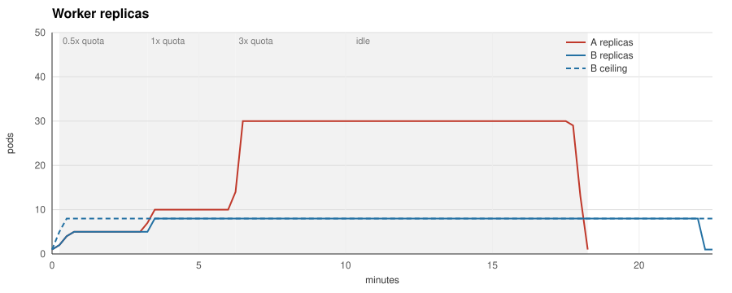
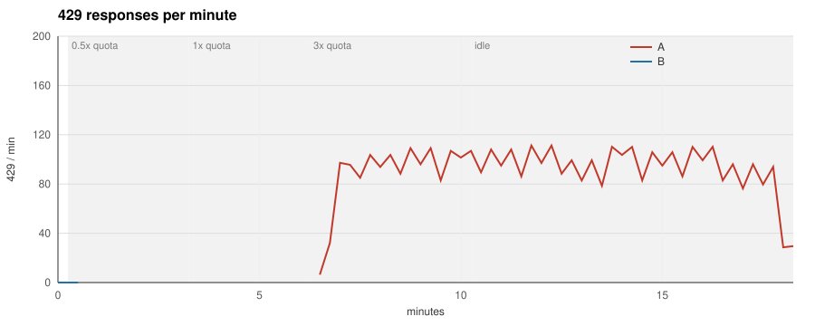

# quotaware

**Scale LLM workers on provider quota, not queue depth.**

A KEDA external scaler for LLM worker deployments. It reads the rate-limit headers
your provider already returns (OpenAI, Anthropic), computes how many worker pods the
remaining quota can actually feed, and caps your existing queue-based trigger at that
number.

## Why

Queue-depth autoscaling past the provider's RPM/TPM limit is a feedback loop: more
pods, more 429s, more backoff, longer queue, more pods. The headers to stop it are on
every response; nothing wires them to the autoscaler.

## What it changes

Same queue, same fake provider limited to 600 requests per minute, same seed. Run A
scales on queue depth alone; run B caps the same trigger with the quotaware ceiling.

| Metric | A (queue trigger) | B (queue trigger + quotaware) |
|---|---|---|
| Jobs produced | 9900 | 9900 |
| Jobs completed | 9848 | 9875 |
| Jobs failed | 0 | 0 |
| 429 responses | 1140 | 0 |
| Retries | 1140 | 0 |
| Peak 429 per minute | 111 | 0 |
| Job latency p50 | 157.9 s | 263.4 s |
| Job latency p95 | 454.8 s | 689.3 s |
| Peak replicas | 30 | 8 |
| Pod-seconds | 23700 | 9945 |
| Idle pod-seconds (in backoff) | 13681 | 0 |
| Time to drain the burst | 465 s | 720 s |
| Time to react after the first 429 | n/a (no ceiling) | no 429 observed |

`make bench` reproduces both runs on a laptop; `docs/benchmark.md` describes the
setup, the hypothesis written before the first run and how each number is measured.

## How it works

1. `quotaware proxy` sits in front of the provider and records rate-limit headers,
   usage, latency and 429s per `(provider, model, key)`.
2. The headroom algorithm turns remaining quota, tokens per call and latency into a
   replica ceiling, with an AIMD fallback when headers are missing.
3. The KEDA external scaler in `quotaware all` serves that ceiling over gRPC; a
   `scalingModifiers` formula takes the minimum of your queue trigger and the ceiling.

## Try it without a cluster

`quotaware simulate` replays a JSONL file of observations through the headroom
algorithm and prints the replica ceiling it would report for each one:

    go run ./cmd/quotaware simulate -concurrency 4 -max 40 -input cmd/quotaware/testdata/observations.jsonl | column -t

    at                    ceiling  reason    allowed_rate  pod_rate
    2026-11-01T18:00:00Z  4        headroom  8.36          2.00
    2026-11-01T18:00:20Z  3        headroom  7.44          2.00
    2026-11-01T18:00:55Z  3        headroom  6.80          2.00
    2026-11-01T18:00:59Z  3        drain     0.00          2.00
    2026-11-01T18:01:05Z  4        headroom  8.50          2.00
    2026-11-01T18:04:00Z  4        frozen    0.00          0.00

Each input line is one JSON object describing a bucket at a point in time:

    {"at":"2026-11-01T18:00:00Z","requests":{"limit":1000,"remaining":990,"reset_at":"2026-11-01T18:01:00Z"},"tokens":{"limit":600000,"remaining":590000,"reset_at":"2026-11-01T18:01:00Z"},"tokens_per_call":1000,"latency_ms":2000,"in_flight":4}

`at` is the evaluation time. `observed_at` is optional and defaults to `at`; set it
earlier to replay a stale bucket. `requests` and `tokens` carry the provider's
limit, remaining and reset for the window; leave one out when the provider does
not report it. `project_tokens` is the optional OpenAI project-level token window. `tokens_per_call` and `latency_ms` are the smoothed averages the
proxy would hold, `in_flight` the calls currently open. Unknown keys are rejected.

Output is tab-separated. The reason column says which rule produced the number:
the headroom formula, a clamp to `-min` or `-max`, the `-max-step-up` cap on
raises, the drain guard that keeps pods alive for calls in flight, a frozen
ceiling for stale observations, or the default when nothing usable was observed.
Run with `-h` for every knob.

## Run the proxy

The proxy forwards `POST /v1/chat/completions` to OpenAI and `POST /v1/messages`
to Anthropic without touching the request or the response, streams included, and
records what it sees per `(provider, model, credential hash)`. Point your workers'
`base_url` at it:

    quotaware proxy -listen :8080 -admin :9100

`-openai-upstream` and `-anthropic-upstream` default to the public APIs. The admin
port serves `/metrics`, `/healthz` and `/v1/observe`; the last one needs a token (see
below). A client that stalls while sending a request body gets 408 after
`-read-body-timeout` (30 s); the buffered body is handed to the transport as
replayable, so a stale pooled connection is retried instead of answered with 502.

To see it work without a provider account, `docker compose up --build` starts the
proxy in front of `bench/fakeprovider`, a provider stand-in with real rate-limit
headers in both formats, 429s with `retry-after`, SSE streams and a deterministic
seed. The same stack backs `make e2e`. A session against a provider limited to
three requests per minute:

    $ curl -si localhost:18080/v1/chat/completions -H "Authorization: Bearer sk-demo" \
        -d '{"model":"gpt-4.1-mini","messages":[{"role":"user","content":"hello"}]}'
    HTTP/1.1 200 OK
    X-Ratelimit-Limit-Requests: 3
    X-Ratelimit-Remaining-Requests: 2
    X-Ratelimit-Reset-Requests: 59.943s
    X-Ratelimit-Limit-Tokens: 50000
    X-Ratelimit-Remaining-Tokens: 49833
    ...
    {"choices":[...],"usage":{"completion_tokens":150,"prompt_tokens":17,"total_tokens":167}}

    $ for i in 1 2 3; do curl -s -o /dev/null -w "%{http_code} retry-after=%header{retry-after}\n" ...; done
    200 retry-after=
    200 retry-after=
    429 retry-after=60

    $ curl -s localhost:19100/metrics | grep -E "^quotaware_(remaining|tokens_per_call|429|retry)"
    quotaware_429_total{key="05eeabac53a7",model="gpt-4.1-mini",provider="openai"} 1
    quotaware_remaining_requests{key="05eeabac53a7",model="gpt-4.1-mini",provider="openai"} 0
    quotaware_remaining_tokens{key="05eeabac53a7",model="gpt-4.1-mini",provider="openai",window="tokens"} 49499
    quotaware_retry_after_seconds{key="05eeabac53a7",model="gpt-4.1-mini",provider="openai"} 60
    quotaware_tokens_per_call{key="05eeabac53a7",model="gpt-4.1-mini",provider="openai"} 167

What the proxy records per bucket: the limit, remaining and reset of every window
the provider reports, a smoothed tokens-per-call and latency over successful calls,
calls in flight, 429s with their `retry-after`, upstream failures (including a body
that broke mid-stream), streams the client abandoned, and how often headers were
missing or malformed or usage was absent. A malformed header spoils only its own
window; the windows that parsed still count. Buckets that see no traffic for ten
minutes are dropped, and at most `-max-buckets` (10000) are tracked: calls on new
buckets beyond that are counted in `quotaware_buckets_rejected_total` and ignored. Tokens per call count what the provider charges against the quota: prompt
plus completion tokens for OpenAI, uncached input plus cache writes plus output for
Anthropic. Usage comes from the response body, so OpenAI streams only report it when
the client sets `stream_options.include_usage`; a stream without it is counted in
`quotaware_usage_missing_total` instead of guessed. The credential is hashed before
it becomes a label.

## Deploy with KEDA

The chart runs `quotaware all`: the proxy, the metrics endpoint and the KEDA
external scaler in one pod, from the image `ghcr.io/dimonchik03/quotaware` that
every release publishes for linux/amd64 and linux/arm64:

    helm install quotaware deploy/helm/quotaware -n llm --create-namespace \
      --set observe.token="$(openssl rand -hex 16)"

The chart refuses to render without `observe.token`, `observe.existingSecret` or an
explicit `observe.insecure=true`. The proxy, gRPC and admin ports carry no
authentication of their own: keep them inside the cluster and restrict them with a
NetworkPolicy to the workers, KEDA and Prometheus.

Point your workers at `http://quotaware.llm.svc:8080` and add the ceiling as a second
trigger next to your queue trigger. KEDA takes the largest value across triggers, so
the two are combined with `scalingModifiers` into a minimum (ADR 0005). Inside a
formula KEDA uses the raw trigger values and ignores each trigger's own target, so the
queue length is divided by the jobs-per-replica target in the formula itself:

    advanced:
      scalingModifiers:
        formula: "demand / 10 < ceiling ? demand / 10 : ceiling"
        target: "1"
        metricType: AverageValue
    triggers:
      - type: redis
        name: demand
        metadata:
          address: redis:6379
          listName: jobs
          listLength: "10"
      - type: external
        name: ceiling
        metadata:
          scalerAddress: quotaware.llm.svc:9090
          bucket: openai/gpt-4.1-mini
          concurrency: "4"

`bucket` is `provider/model`; `concurrency` is how many provider calls one worker pod
keeps open; `maxReplicas` has to mirror `maxReplicaCount` by hand because KEDA does
not pass it to external scalers. With `scalingModifiers` KEDA activates the
ScaledObject when the formula result is above `activationTarget` (default 0), so an
exhausted quota with `minReplicaCount: 0` scales to zero; keep `minReplicaCount` at
one or more when the workers must stay warm. If quotaware is unreachable the HPA
keeps the current replica count. Full manifests for this mode and for the
single-trigger mode (quotaware reads the Redis list itself and returns the minimum)
are in `deploy/examples/`. Single-trigger mode only reads the Redis addresses listed
in `redisAddresses` (the `-redis-address` flag); any other `redisAddress` in trigger
metadata is answered with PermissionDenied. Each quotaware serves at most
`-max-scaled-objects` (1000) ScaledObjects; the rest get ResourceExhausted. The
remaining knobs (`credential`, `safety`, `share`,
`maxStepUp`, `stepInterval`, `defaultCeiling`, `minReplicas`, `staleAfter`,
`staleHard`, `window`) and their defaults are listed in `docs/SPEC.md`. A Grafana
dashboard is in `deploy/grafana/`.

## Without the proxy hop

Workers that cannot or should not route through the proxy can report what they
see themselves. Both collectors post the same observation to `POST /v1/observe` on
the admin port and never block or fail the call they observe: a full queue drops, a
failed delivery is counted, an error inside the hook is counted. quotaware refuses
to start without `-observe-token` (or `QUOTAWARE_OBSERVE_TOKEN`) unless
`-observe-insecure` is passed, because anyone who can post an observation can move
the ceiling; give the collectors the same token.

    import "github.com/dimonchik03/quotaware/collector"

    c, err := collector.New(collector.DefaultConfig("http://quotaware:9100", "openai"))
    defer c.Close()
    client := &http.Client{Transport: c.Wrap(http.DefaultTransport)}

    from quotaware_httpx import QuotawareHook

    hook = QuotawareHook("http://quotaware:9100", "openai")
    client = httpx.Client(base_url="https://api.openai.com", event_hooks=hook.hooks())

The Python hook is one module in `collector/python/` with a `pyproject.toml`; copy
the file or `pip install ./collector/python`. It reads usage from JSON responses;
a stream is observed when it is closed, with the latency measured to the end and
`complete` false if the caller abandoned it. Collector traffic is not counted as in
flight, so the drain guard only sees proxied calls (ADR 0007).

## When the headers are missing

Buckets without a usable quota, because the provider or a gateway strips the
headers or the last observation is older than `staleHard`, are driven by AIMD:
start at `defaultCeiling`, add `aimdIncrease` per `stepInterval` of clean traffic,
multiply by `aimdDecrease` (0.5) when more than `aimdThreshold` (2 %) of the last
minute's responses were 429, then hold for the longest `retry-after` seen and at
least one minute, so one burst is halved once. The same rule guards a header-derived
ceiling, so a burst of 429s halves it even while the headers still look healthy.
`quotaware_rate_limited_ratio` shows the share the rule reacts to (ADR 0006).

## Watch it on kind

    make demo        # kind cluster, KEDA 2.21, fake provider, Redis, workers, quotaware
    make demo-down

The demo creates a cluster with its own kubeconfig under `bench/kind/`, so your
default context is never touched. Workers are curl loops (two calls in flight per
pod, backing off on `retry-after`) scaled by the Mode A ScaledObject against a fake
provider limited to 600 requests per minute; 200 queued jobs keep demand at 20. After
90 seconds a job with another credential bursts the shared quota for a minute:

    time      replicas  desired  429/15s ceiling (quotaware log)
    21:40:33  -         -        0      0 -> 8 (headroom)
    21:40:49  8         8        0
    21:41:50  8         8        0
    21:42:05  burst job started: 30 loops with another credential for 60s
    21:42:21  8         7        0      8 -> 7 (drain)
    21:43:07  7         1        0      3 -> 1 (clamped)
    21:43:23  1         1        0
    21:43:38  1         5        0      1 -> 5 (step_up)
    21:43:53  5         8        0      5 -> 8 (headroom)
    21:44:09  8         8        0

Eight replicas is what 600 requests per minute feeds at one call per second per pod
with the safety factor applied; the workers never see a 429. When the burst drains
the window, the ceiling drops and the HPA follows within a poll; after the window
resets the ceiling steps back up by `maxStepUp` per interval.

## Non-goals

Not a gateway, not a rate limiter, not a cost dashboard. See `docs/SPEC.md`.

## Status

v0.1.0 is released: binaries for Linux and macOS on the releases page, the image on
`ghcr.io`, everything in `docs/SPEC.md` implemented and benchmarked. See
`docs/design.md` for how the pieces fit and `docs/release.md` for how a release is
cut. Specification in `docs/SPEC.md`,
decisions in `docs/adr`.

## License

MIT
