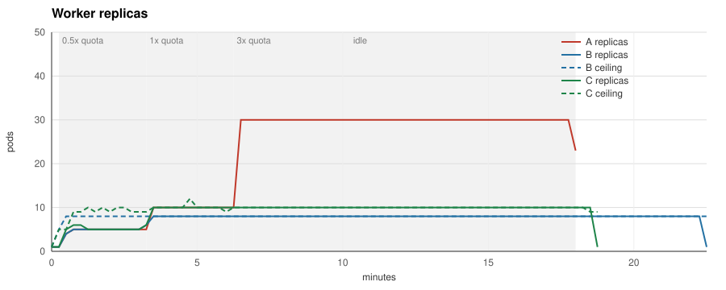
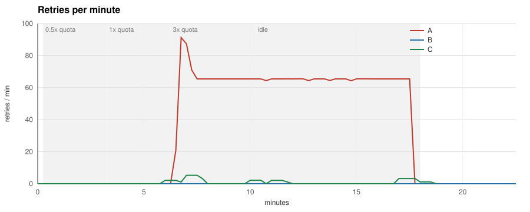

# quotaware

**Scale LLM workers on provider quota, not queue depth.**

A KEDA external scaler for LLM worker deployments. It reads the rate-limit headers
your provider already returns (OpenAI, Anthropic), computes how many worker pods the
remaining quota can actually feed, and caps your existing queue-based trigger at that
number.

## Why

Past the provider's RPM/TPM limit, queue-depth autoscaling keeps adding pods the
quota cannot feed: throughput stays at the quota, and the extra capacity goes into
429s and backoff while the queue still looks long. The headers that say how much
quota is left are on every response; nothing wires them to the autoscaler.

## What it changes

Same queue, same fake provider limited to 600 requests per minute, same job
schedule. Run A scales on queue depth alone; runs B and C cap the same trigger with
the quotaware ceiling, at the default safety factor 0.85 and at 1, both with
`maxStepUp: "4"`, twice the default.

| Metric | A (queue trigger) | B (queue trigger + quotaware, safety 0.85) | C (queue trigger + quotaware, safety 1) |
|---|---|---|---|
| Jobs produced | 9900 | 9900 | 9900 |
| Jobs completed | 9900 | 9900 | 9900 |
| Jobs failed | 0 | 0 | 0 |
| Jobs abandoned on shutdown | 0 | 0 | 0 |
| Jobs unaccounted for | 0 | 0 | 0 |
| 429 responses | 720 | 0 | 15 |
| Retries | 720 | 0 | 15 |
| Peak retries per minute | 91 | 0 | 5 |
| Job latency p50 | 128.1 s | 263.6 s | 164.8 s |
| Job latency p95 | 457.7 s | 689.5 s | 463.1 s |
| Peak replicas | 30 | 8 | 10 |
| Pod-seconds | 23580 | 10050 | 10125 |
| Idle pod-seconds (in backoff) | 13300 | 0 | 8 |
| Time to drain the burst | 450 s | 720 s | 495 s |

Read it as a trade-off set by `safety`. At 0.85 quotaware ends every 429 and cuts
the pod-seconds by more than half, but leaves 20 % of the quota unused, so under
sustained overload jobs wait longer: about 50 % at p95 and twice as long at p50, as
far as the latency histogram resolves. At 1 it ties the baseline's p95 within one
histogram bucket, with 43 % of the pod-seconds and 2 % of the 429s, while its p50
sits one bucket higher (about 29 %) and the burst takes 10 % longer to drain. The
quota and the latency stay constant here, so a static `maxReplicaCount` of 10 would
likely do as well as C. The ceiling is meant for headroom that moves: the kind demo
below shows it following another credential's burst on the shared quota, a case the
benchmark does not measure yet. The fixed window of the fake provider also hands the
baseline a head start through the burst, about the size of C's p50 and drain gaps.
`make bench` reproduces all three runs on a laptop; `docs/benchmark.md` has the
setup, the hypothesis written before the first run (C was added after it), the result
against it and how each number is measured.

## How it works

1. `quotaware proxy` sits in front of the provider and records rate-limit headers,
   usage, latency and 429s per `(provider, model, key)`.
2. The headroom algorithm turns remaining quota, tokens per call and latency into a
   replica ceiling, with an AIMD fallback when headers are missing.
3. The KEDA external scaler in `quotaware all` serves that ceiling over gRPC; a
   `scalingModifiers` formula takes the minimum of your queue trigger and the ceiling.

## Try it without a cluster

`quotaware simulate` replays a JSONL file of observations through the headroom
algorithm and prints the replica ceiling it would report for each one:

    go run ./cmd/quotaware simulate -concurrency 4 -max 40 -input cmd/quotaware/testdata/observations.jsonl | column -t

    at                    ceiling  reason    allowed_rate  pod_rate
    2026-11-01T18:00:00Z  4        headroom  8.36          2.00
    2026-11-01T18:00:20Z  3        headroom  7.44          2.00
    2026-11-01T18:00:55Z  3        headroom  6.80          2.00
    2026-11-01T18:00:59Z  3        drain     0.00          2.00
    2026-11-01T18:01:05Z  2        drain     8.50          2.00
    2026-11-01T18:01:25Z  3        step_up   8.50          2.00
    2026-11-01T18:04:00Z  3        frozen    0.00          0.00

Each input line is one JSON object describing a bucket at a point in time:

    {"at":"2026-11-01T18:00:00Z","requests":{"limit":1000,"remaining":990,"reset_at":"2026-11-01T18:01:00Z"},"tokens":{"limit":600000,"remaining":590000,"reset_at":"2026-11-01T18:01:00Z"},"tokens_per_call":1000,"latency_ms":2000,"in_flight":4}

`at` is the evaluation time. `observed_at` is optional and defaults to `at`; set it
earlier to replay a stale bucket. `requests` and `tokens` carry the provider's
limit, remaining and reset for the window; leave one out when the provider does
not report it. `project_tokens` is the optional OpenAI project-level token window. `tokens_per_call` and `latency_ms` are the smoothed averages the
proxy would hold, `in_flight` the calls currently open. Unknown keys are rejected.

Output is tab-separated. The reason column says which rule produced the number:
the headroom formula, a clamp to `-min` or `-max`, the step-up rule (a raise waits
`-step-interval` after the last change and then climbs by at most `-max-step-up`),
the drain guard that keeps pods alive for calls in flight, a frozen ceiling for
stale observations, or the default when nothing usable was observed. In the run
above the quota is spent at 18:00:59; after the window resets the raise waits out
the step interval, the drain guard keeps two pods for the eight open calls, and at
18:01:25 the ceiling climbs by two. `simulate` replays the headroom rules the scaler applies,
without the AIMD guard, which needs the 429 history of a live bucket. Run with
`-h` for every knob.

## Run the proxy

The proxy forwards `POST /v1/chat/completions` to OpenAI and `POST /v1/messages`
to Anthropic without touching the request or the response, streams included, and
records what it sees per `(provider, model, credential hash)`. Every other path,
embeddings and the Responses API included, gets 404, so point only the clients that
make those two calls at it: OpenAI SDKs with `base_url` `http://<proxy>:8080/v1`,
Anthropic SDKs with `http://<proxy>:8080`, since they add `/v1` themselves.

    QUOTAWARE_OBSERVE_TOKEN="$(openssl rand -hex 16)" quotaware proxy -listen :8080 -admin :9100

`-openai-upstream` and `-anthropic-upstream` default to the public APIs. The admin
port serves `/metrics`, `/healthz` and `/v1/observe`; the last one needs a token (see
below). A client that stalls while sending a request body gets 408 after
`-read-body-timeout` (30 s); the buffered body is handed to the transport as
replayable, so a stale pooled connection is retried instead of answered with 502.

To see it work without a provider account, `docker compose up --build` starts the
proxy in front of `bench/fakeprovider`, a provider stand-in with real rate-limit
headers in both formats, 429s with `retry-after`, SSE streams and seeded
latency jitter and response text. The same stack backs `make e2e`. A session against a provider limited to
three requests per minute:

    $ curl -si localhost:18080/v1/chat/completions -H "Authorization: Bearer sk-demo" \
        -d '{"model":"gpt-4.1-mini","messages":[{"role":"user","content":"hello"}]}'
    HTTP/1.1 200 OK
    X-Ratelimit-Limit-Requests: 3
    X-Ratelimit-Remaining-Requests: 2
    X-Ratelimit-Reset-Requests: 59.943s
    X-Ratelimit-Limit-Tokens: 50000
    X-Ratelimit-Remaining-Tokens: 49833
    ...
    {"choices":[...],"usage":{"completion_tokens":150,"prompt_tokens":17,"total_tokens":167}}

    $ for i in 1 2 3; do curl -s -o /dev/null -w "%{http_code} retry-after=%header{retry-after}\n" ...; done
    200 retry-after=
    200 retry-after=
    429 retry-after=60

    $ curl -s localhost:19100/metrics | grep -E "^quotaware_(remaining|tokens_per_call|429|retry)"
    quotaware_429_total{key="05eeabac53a7",model="gpt-4.1-mini",provider="openai"} 1
    quotaware_remaining_requests{key="05eeabac53a7",model="gpt-4.1-mini",provider="openai"} 0
    quotaware_remaining_tokens{key="05eeabac53a7",model="gpt-4.1-mini",provider="openai",window="tokens"} 49499
    quotaware_retry_after_seconds{key="05eeabac53a7",model="gpt-4.1-mini",provider="openai"} 60
    quotaware_tokens_per_call{key="05eeabac53a7",model="gpt-4.1-mini",provider="openai"} 167

What the proxy records per bucket: the limit, remaining and reset of every window
the provider reports, a smoothed tokens-per-call and latency over successful calls,
calls in flight, 429s with their `retry-after`, upstream failures (including a body
that broke mid-stream), streams the client abandoned, and how often headers were
missing or malformed or usage was absent. A malformed header spoils only its own
window; the windows that parsed still count. Buckets that see no traffic for ten
minutes are dropped, and at most `-max-buckets` (10000) are tracked: calls on new
buckets beyond that are counted in `quotaware_buckets_rejected_total` and ignored. Tokens per call count what the provider charges against the quota: prompt
plus completion tokens for OpenAI, uncached input plus cache writes plus output for
Anthropic. Usage comes from the response body, so OpenAI streams only report it when
the client sets `stream_options.include_usage`; a stream without it is counted in
`quotaware_usage_missing_total` instead of guessed. The credential is hashed before
it becomes a label.

## Deploy with KEDA

The chart runs `quotaware all`: the proxy, the metrics endpoint and the KEDA
external scaler in one pod, from the image `ghcr.io/dimonchik03/quotaware` that
every release publishes for linux/amd64 and linux/arm64:

    git clone --branch v0.2.0 https://github.com/dimonchik03/quotaware && cd quotaware
    kubectl create namespace llm
    kubectl -n llm create secret generic quotaware-observe \
      --from-literal=observe-token="$(openssl rand -hex 16)"
    helm install quotaware deploy/helm/quotaware -n llm \
      --set observe.existingSecret=quotaware-observe

Collectors read the same secret, so the token never passes through a values file.
`--set observe.token=...` works too and lets the chart create the secret and roll the
pod when the token changes; with `existingSecret` restart the pod after a rotation.

Install from a release tag: the chart's `appVersion` picks the image, and the chart
on `main` may already pass flags that only the next release understands.

The chart refuses to render without `observe.token`, `observe.existingSecret` or an
explicit `observe.insecure=true`. The proxy, gRPC and admin ports carry no
authentication of their own, so the chart ships a NetworkPolicy, on by default, that
admits KEDA's operator from the `keda` namespace to the gRPC port and the release
namespace to the proxy and admin ports. Set `networkPolicy.keda.namespace` and
`networkPolicy.keda.podLabels` when KEDA runs elsewhere or under other labels. Peers
from other namespaces go under `networkPolicy.proxyFrom` for workers that call the
proxy, `networkPolicy.adminFrom` for collectors posting to `/v1/observe` and for
Prometheus, and `networkPolicy.grpcFrom` for anything besides KEDA that must reach
the scaler. A CNI that does not enforce policies ignores it (ADR 0009). The pod runs
as a non-root user with a read-only root filesystem, no capabilities, the default
seccomp profile and no service account token, so it fits the `restricted` Pod
Security level; `podSecurityContext` and `securityContext` override that.

Point your workers at `http://quotaware.llm.svc:8080` (`/v1` appended for OpenAI
SDKs) and add the ceiling as a second
trigger next to your queue trigger. KEDA takes the largest value across triggers, so
the two are combined with `scalingModifiers` into a minimum (ADR 0005). Inside a
formula KEDA uses the raw trigger values and ignores each trigger's own target, so the
queue length is divided by the jobs-per-replica target in the formula itself:

    advanced:
      scalingModifiers:
        formula: "demand / 10 < ceiling ? demand / 10 : ceiling"
        target: "1"
        metricType: AverageValue
    triggers:
      - type: redis
        name: demand
        metadata:
          address: redis.llm.svc:6379
          listName: jobs
          listLength: "10"
      - type: external
        name: ceiling
        metadata:
          scalerAddress: quotaware.llm.svc:9090
          bucket: openai/gpt-4.1-mini
          concurrency: "4"

KEDA's operator dials `scalerAddress` and the Redis `address` from its own namespace,
so both need the `<service>.<namespace>.svc` form. `bucket` is `provider/model`;
`concurrency` is how many provider calls one worker pod
keeps open; `maxReplicas` has to mirror `maxReplicaCount` by hand because KEDA does
not pass it to external scalers. With `scalingModifiers` KEDA activates the
ScaledObject when the formula result is above `activationTarget` (default 0), so an
exhausted quota with `minReplicaCount: 0` scales to zero; keep `minReplicaCount` at
one or more when the workers must stay warm. If quotaware is unreachable the HPA
keeps the current replica count. Full manifests for this mode and for the
single-trigger mode (quotaware reads the Redis list itself and returns the minimum,
never below the pods the open calls need)
are in `deploy/examples/`. Single-trigger mode only reads the Redis addresses listed
in `redisAddresses` (the `-redis-address` flag); any other `redisAddress` in trigger
metadata is answered with PermissionDenied; the reader connects without password or
TLS, so keep that Redis inside the cluster network. Each quotaware tracks at most
`-max-scaled-objects` (1000) ceilings, one per ScaledObject, trigger and credential;
a poll that needs a new one beyond that gets ResourceExhausted. Ceiling
state is kept per ScaledObject and trigger metadata, so a caller on the gRPC port
that sends other metadata for the same name gets its own entry and cannot move yours.
Editing the trigger metadata, to tune `safety` for instance, starts that state
afresh: an AIMD ceiling restarts at `defaultCeiling` and a header ceiling skips the
`maxStepUp` limit once. Providers scope rate limits to the organization or project,
not to the key, so the credentials that match a trigger count as views of one quota:
the newest headers among them decide the ceiling, and one drain floor covers the calls
open on all of them. A trigger whose keys each have a quota of their own, keys of
separate organizations for instance, sets `quotaScope: credential` to add their
ceilings up instead (ADR 0010). A key the provider has only answered with 401 or 403
counts for nothing. Set `credential` when other teams' keys for the same model go
through the same proxy, or their headers may be the newest.
The remaining knobs (`credential`, `quotaScope`, `safety`, `share`,
`maxStepUp`, `stepInterval`, `defaultCeiling`, `minReplicas`, `staleAfter`,
`staleHard`, `window`) and their defaults are listed in `docs/SPEC.md`. A Grafana
dashboard is in `deploy/grafana/`.

## Without the proxy hop

Workers that cannot or should not route through the proxy can report what they
see themselves. Both collectors post the same observation to `POST /v1/observe` on
the admin port and never block or fail the call they observe: a full queue drops, a
failed delivery is counted, an error inside the hook is counted. quotaware refuses
to start without `-observe-token` (or `QUOTAWARE_OBSERVE_TOKEN`) unless
`-observe-insecure` is passed, because anyone who can post an observation can move
the ceiling; give the collectors the same token.

    import "github.com/dimonchik03/quotaware/collector"

    cfg := collector.DefaultConfig("http://quotaware:9100", "openai")
    cfg.Token = os.Getenv("QUOTAWARE_OBSERVE_TOKEN")
    c, err := collector.New(cfg)
    if err != nil {
        return err
    }
    defer c.Close()
    client := &http.Client{Transport: c.Wrap(http.DefaultTransport)}

    import os

    import httpx
    from openai import AsyncOpenAI, OpenAI
    from quotaware_httpx import QuotawareHook

    hook = QuotawareHook("http://quotaware:9100", "openai", token=os.environ["QUOTAWARE_OBSERVE_TOKEN"])
    client = OpenAI(http_client=httpx.Client(event_hooks=hook.hooks()))
    async_client = AsyncOpenAI(http_client=httpx.AsyncClient(event_hooks=hook.async_hooks()))

The Python hook is one module in `collector/python/` with a `pyproject.toml`; copy
the file or `pip install ./collector/python`. `hooks()` is for `httpx.Client`,
`async_hooks()` for `httpx.AsyncClient`; httpx awaits every hook of an async
client, so the two cannot be swapped. Both collectors read usage from JSON bodies and
from SSE streams (OpenAI with `stream_options.include_usage`, Anthropic always),
gzip included; a body that is not JSON still reports its headers. A stream is
observed when it is closed, with the latency measured to the end and `complete`
false if the caller abandoned it; a body that breaks reaches the caller with its own
error. The Python hook logs through the `quotaware_httpx` logger when deliveries
start failing and when they recover, restarts its delivery thread in a forked child
(Celery prefork, gunicorn `--preload`), and `close()` returns how many observations
it could not deliver; the Go collector's `Close` returns `ErrUndelivered` then.
Collector traffic is not counted as in flight, so the drain guard only sees proxied
calls (ADR 0007).

## When the headers are missing

Buckets without a usable quota, because the provider or a gateway strips the
headers or the last observation is older than `staleHard`, are driven by AIMD:
start at `defaultCeiling`, add `aimdIncrease` per `stepInterval` of clean traffic,
multiply by `aimdDecrease` (0.5) when more than `aimdThreshold` (2 %) of the last
minute's accepted responses, 2xx and 429, were 429, then hold for the longest
`retry-after` seen and at
least one minute, so one burst is halved once. The same rule guards a header-derived
ceiling, so a burst of 429s halves it even while the headers still look healthy.
`quotaware_rate_limited_ratio` shows the share the rule reacts to (ADR 0006).

## Watch it on kind

    make demo        # kind cluster, KEDA 2.21, fake provider, Redis, workers, quotaware
    make demo-down

The demo creates a cluster with its own kubeconfig under `bench/kind/`, so your
default context is never touched. Workers are curl loops (two calls in flight per
pod, backing off on `retry-after`) scaled by the two-trigger ScaledObject in
`bench/kind/manifests/40-scaledobject.yaml` against a fake provider limited to 600
requests per minute in one window per model that every key shares; 200 queued jobs
keep demand at 20. After 90 seconds a job with another credential bursts the shared
quota for a minute:

    time      replicas  desired  ceiling (quotaware log)
    21:40:33  -         -        0 -> 8 (headroom)
    21:40:49  8         8
    21:41:50  8         8
    21:42:05  burst job started: 30 loops with another credential for 60s
    21:42:21  8         7        8 -> 7 (drain)
    21:43:07  7         1        3 -> 1 (clamped)
    21:43:23  1         1
    21:43:38  1         5        1 -> 5 (step_up)
    21:43:53  5         8        5 -> 8 (headroom)
    21:44:09  8         8

Eight replicas is what 600 requests per minute feeds at about one call per second per
pod with the safety factor applied. Once the burst has spent the shared window, every
call gets a 429 until the reset, the workers' included: the ceiling follows the
remaining quota down, so fewer worker pods sit in backoff, and after the window resets
it steps back up by `maxStepUp` per interval. The log shows the last ceiling change of
each 15 s line only. The demo also prints the workers' 429s per line; this recording
predates a fix to that count, so the column is left out.

## Command line

`quotaware proxy` runs the proxy and the admin port; `quotaware all` adds the KEDA
scaler; `quotaware simulate -h` lists the knobs of the replay; `quotaware version`
prints the build version.

| Flag | Default | Meaning |
|---|---|---|
| `-listen` | `:8080` | proxy address |
| `-admin` | `:9100` | `/metrics`, `/healthz` and `/v1/observe` |
| `-grpc` (`all`) | `:9090` | KEDA external scaler |
| `-openai-upstream`, `-anthropic-upstream` | public APIs | origins the proxy forwards to |
| `-observe-token` | `$QUOTAWARE_OBSERVE_TOKEN` | bearer token collectors present |
| `-observe-insecure` | off | accept observations without a token |
| `-ewma-alpha` | `0.2` | weight of the newest sample in tokens per call and latency |
| `-max-buckets` | `10000` | `(provider, model, credential)` buckets tracked |
| `-max-scaled-objects` | `1000` | `(ScaledObject, trigger, credential)` ceilings tracked |
| `-max-request-bytes` | 8 MiB | largest request body accepted |
| `-max-capture-bytes` | 4 MiB | largest response body read for usage |
| `-read-body-timeout` | `30s` | time a client may take to send the request body |
| `-redis-address` (`all`) | none | Redis addresses single-trigger mode may read |
| `-push-interval` (`all`) | `5s` | how often `StreamIsActive` re-checks a queue |

## Non-goals

Not a gateway, not a rate limiter, not a cost dashboard. See `docs/SPEC.md`.

## Status

v0.2.0 is the current release: binaries for Linux and macOS on the releases page, the
image `ghcr.io/dimonchik03/quotaware:0.2.0`, the v0.x scope of `docs/SPEC.md`
implemented, and the two-trigger mode benchmarked against a fixed-window fake
provider. Over v0.1.0 it adds the network defaults of ADR 0008
and 0009 (observe token, NetworkPolicy, Redis allow list, ceiling state bound to the
trigger), the store limits, async hooks for the Python collector and the three-run
benchmark above.

Upgrading from v0.1.0: quotaware now refuses to start without an observe token and
the chart refuses to render without `observe.token`, `observe.existingSecret` or
`observe.insecure=true`; give collectors the same token. The NetworkPolicy is on by
default, so on a CNI that enforces it list workers, collectors and Prometheus from
other namespaces under `networkPolicy.proxyFrom` and `networkPolicy.adminFrom`, and a
KEDA outside the `keda` namespace under `networkPolicy.keda`. Single-trigger mode
needs its Redis addresses in `redisAddresses`.

See `docs/design.md` for how the pieces fit and `docs/release.md` for how a release
is cut. Specification in `docs/SPEC.md`, decisions in `docs/adr`.

## License

MIT
