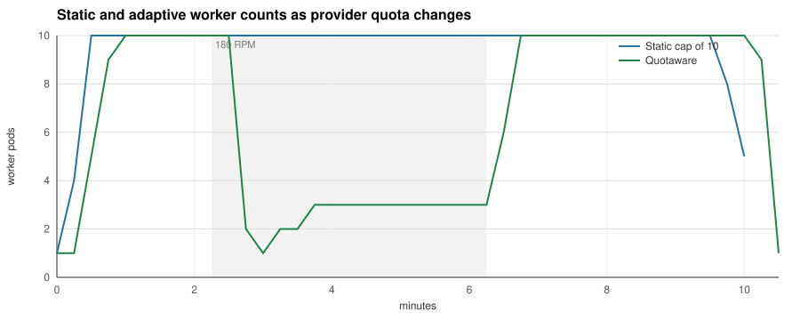

# quotaware

**Cap LLM worker replicas with the quota your provider can actually serve.**

A backlog tells Kubernetes how much work is waiting. OpenAI and Anthropic rate-limit
headers tell it how fast that work can finish. Quotaware combines those signals in a
[KEDA](https://keda.sh/) external scaler. Workers can send requests through the proxy
or report observations with the Go and Python collectors.

[Try the simulator](#try-it-without-a-cluster) · [Run on kind](#watch-it-on-kind) ·
[Deploy with KEDA](#deploy-with-keda) · [Releases](https://github.com/dimonchik03/quotaware/releases)

## When the provider changes its quota

We compared three ways to scale the same LLM workers on a kind cluster on a
GitHub-hosted Ubuntu runner: KEDA's queue-depth trigger alone, the same trigger
with a static maximum of ten workers, and the same trigger capped by Quotaware.
Each trial received 3,960 jobs over six minutes, 10% more than the nominal quota.
The fake provider allowed 600 requests per minute, cut that to 180 for four minutes
after a two-minute warm-up, then restored 600. Ten workers consume the full 600, so
the static cap is the setting a team would pick if it knew the quota in advance.

Three passes ran the arms in the orders A/B/C, C/B/A and B/C/A; each cell shows the
lowest and the highest value. Quotaware uses `safety: "1"` and `maxStepUp: "4"`.
The default safety setting is 0.85. All arms use two concurrent provider calls per
worker.

| Metric | Queue only | Static cap of 10 | Quotaware |
|---|---|---|---|
| Jobs completed, out of 3,960 | 3,960 | 3,960 | 3,960 |
| HTTP 429 responses | 442 | 88–92 | 24–26 |
| Worker pod-seconds | 13,598–13,680 | 5,738–5,805 | 4,215–4,402 |
| Pod-seconds of scheduled retry backoff | 9,602–9,641 | 1,676–1,678 | 416–424 |
| Mean job latency | 113.2–114.5 s | 130.3–130.7 s | 156.0–161.6 s |
| Job latency p95 | 199.8–200.7 s | 213.2–213.4 s | 238.2–243.4 s |
| Time from end of load phase to empty queue | 195 s | 210 s | 240 s |

In every pass Quotaware completed every job with 23–27% fewer worker pod-seconds
and about 72% fewer 429s than the static cap, and with 68–69% fewer pod-seconds and
about 94% fewer 429s than the queue trigger alone. It paid in latency: the mean is
19–24% and the p95 12–14% above the static cap, and the queue empties 30 seconds
later.

Quotaware's backlog falls further behind the static cap's at three moments, each
adding 60 to 130 queued jobs. At the start the ceiling climbs 1, 5, 9, 10 in 15-second steps while
the static arm scales straight to ten. When the first reduced minute is spent, its
reset is still more than 30 seconds away, beyond the default `lookAhead`, so
Quotaware drops to one worker and is back at three within the next minute. When the quota returns to 600,
Quotaware learns it from the first response of the new window and needs about half a
minute to reach ten workers, which the static cap already runs. The static cap wins
on latency because it was chosen for this provider's quota; Quotaware stays within
15% at p95 without being told the quota.

An earlier trial on 2026-11-05 lost jobs and saved only 8% of pod-seconds: the AIMD
guard held the ceiling at one worker past the reset of a spent window, and the bench
worker dropped jobs on scale-down.
[ADR 0013](docs/adr/0013-look-past-a-reset-and-guard-unexplained-429s.md) ignores
429s that the headers explain and counts the refill of a reset less than `lookAhead`
away; the worker now hands a job back to the queue when shutdown interrupts its retry
wait, 18 per Quotaware trial. A crashed worker still loses its job, so
production workers need queue leases.

Each run starts fresh provider windows, workers and scaler state. The published
measurements came from
[commit 6e3723b](https://github.com/dimonchik03/quotaware/commit/6e3723bf8bfbcf9d10568354d85e1e3e04aeb8b4)
on one GitHub-hosted Ubuntu runner; check it out and run `make bench-changing` to
reproduce them.
[Raw data and all three passes](bench/results/2026-11-06-changing/) ·
[Method, the 2026-11-05 trial and the fixed-quota experiment](docs/benchmark.md) ·
[CI execution](https://github.com/dimonchik03/quotaware/actions/runs/42232333742)

## How it works

1. `quotaware proxy` sits in front of the provider and records rate-limit headers,
   usage, latency and 429s per `(provider, model, key)`.
2. The headroom algorithm turns remaining quota, tokens per call and latency into a
   replica ceiling, with an AIMD fallback when headers are missing.
3. The KEDA external scaler in `quotaware all` serves that ceiling over gRPC; a
   `scalingModifiers` formula takes the minimum of your queue trigger and the ceiling.

## Try it without a cluster

`quotaware simulate` replays a JSONL file of observations through the headroom
algorithm and prints the replica ceiling it would report for each one:

    go run ./cmd/quotaware simulate -concurrency 4 -max 40 -input cmd/quotaware/testdata/observations.jsonl | column -t

    at                    ceiling  reason    allowed_rate  pod_rate
    2026-11-01T18:00:00Z  4        headroom  8.36          2.00
    2026-11-01T18:00:20Z  3        headroom  7.44          2.00
    2026-11-01T18:00:55Z  4        headroom  8.22          2.00
    2026-11-01T18:00:59Z  4        headroom  8.22          2.00
    2026-11-01T18:01:05Z  4        headroom  8.50          2.00
    2026-11-01T18:01:25Z  4        headroom  8.50          2.00
    2026-11-01T18:04:00Z  4        frozen    0.00          0.00

Each input line is one JSON object describing a bucket at a point in time:

    {"at":"2026-11-01T18:00:00Z","requests":{"limit":1000,"remaining":990,"reset_at":"2026-11-01T18:01:00Z"},"tokens":{"limit":600000,"remaining":590000,"reset_at":"2026-11-01T18:01:00Z"},"tokens_per_call":1000,"latency_ms":2000,"in_flight":4}

`at` is the evaluation time. `observed_at` is optional and defaults to `at`; set it
earlier to replay a stale bucket. `requests` and `tokens` carry the provider's
limit, remaining and reset for the window; leave one out when the provider does
not report it. `project_tokens` is the optional OpenAI project-level token window.
Each window may carry `reported_at`; one reported longer than `-stale-after` before
`at` no longer bounds the ceiling, as with a project limit that was lifted.
`tokens_per_call` and `latency_ms` are the smoothed averages the proxy would hold,
`in_flight` the calls currently open. Unknown keys are rejected.

Output is tab-separated. The reason column says which rule produced the number:
the headroom formula, a clamp to `-min` or `-max`, the step-up rule (a raise waits
`-step-interval` after the last change and then climbs by at most `-max-step-up`),
the drain guard that keeps pods alive for calls in flight, a frozen ceiling for
stale observations, or the default when nothing usable was observed. In the run
above the window is almost spent at 18:00:55 and empty at 18:00:59. Both lines are
within `-look-ahead` (30 s) of the reset at 18:01:00, so the rate counts the refill
the reset brings and the ceiling stays at 4. With `-look-ahead 0s` the bound drops
to 1 at 18:00:59, the drain guard keeps three pods for the twelve open calls, and
the raise after the reset waits out the step interval. `simulate` replays the
headroom rules the scaler applies, without the AIMD guard, which needs the 429
history of a live bucket, and without a default ceiling reported before the first
observation, which in the scaler limits the first raise. Run with `-h` for every knob.

## Run the proxy

The proxy forwards `POST /v1/chat/completions` to OpenAI and `POST /v1/messages`
to Anthropic without touching the request or the response, streams included, and
records what it sees per `(provider, model, credential hash)`. Every other path,
embeddings and the Responses API included, gets 404, so point only the clients that
make those two calls at it: OpenAI SDKs with `base_url` `http://<proxy>:8080/v1`,
Anthropic SDKs with `http://<proxy>:8080`, since they add `/v1` themselves.

    QUOTAWARE_OBSERVE_TOKEN="$(openssl rand -hex 16)" quotaware proxy -listen :8080 -admin :9100

`-openai-upstream` and `-anthropic-upstream` default to the public APIs. The admin
port serves `/metrics`, `/healthz` and `/v1/observe`; the last one needs a token (see
below). A client that stalls while sending a request body gets 408 after
`-read-body-timeout` (30 s); the buffered body is handed to the transport as
replayable, so a pooled connection found dead before the request is written is
retried instead of answered with 502. A provider that accepts the connection but
sends no response headers within `-upstream-header-timeout` (10 min, the SDKs' own
default), or whose dial or TLS handshake times out, gets 504 and counts as an
upstream error, so a hung provider cannot park calls and their buffers for good. At most `-max-inflight` (256) proxied calls are
open at once; a call beyond that is answered 503 before its body is read and
counted in `quotaware_calls_rejected_total`.

To see it work without a provider account, `docker compose up --build` starts the
proxy in front of `bench/fakeprovider`, a provider stand-in with real rate-limit
headers in both formats, 429s with `retry-after`, SSE streams and seeded
latency jitter and response text. The same stack backs `make e2e`. A session against a provider limited to
three requests per minute:

    $ curl -si localhost:18080/v1/chat/completions -H "Authorization: Bearer sk-demo" \
        -d '{"model":"gpt-4.1-mini","messages":[{"role":"user","content":"hello"}]}'
    HTTP/1.1 200 OK
    X-Ratelimit-Limit-Requests: 3
    X-Ratelimit-Remaining-Requests: 2
    X-Ratelimit-Reset-Requests: 59.943s
    X-Ratelimit-Limit-Tokens: 50000
    X-Ratelimit-Remaining-Tokens: 49833
    ...
    {"choices":[...],"usage":{"completion_tokens":150,"prompt_tokens":17,"total_tokens":167}}

    $ for i in 1 2 3; do curl -s -o /dev/null -w "%{http_code} retry-after=%header{retry-after}\n" ...; done
    200 retry-after=
    200 retry-after=
    429 retry-after=60

    $ curl -s localhost:19100/metrics | grep -E "^quotaware_(remaining|tokens_per_call|429|retry)"
    quotaware_429_total{key="05eeabac53a7",model="gpt-4.1-mini",provider="openai"} 1
    quotaware_remaining_requests{key="05eeabac53a7",model="gpt-4.1-mini",provider="openai"} 0
    quotaware_remaining_tokens{key="05eeabac53a7",model="gpt-4.1-mini",provider="openai",window="tokens"} 49499
    quotaware_retry_after_seconds{key="05eeabac53a7",model="gpt-4.1-mini",provider="openai"} 60
    quotaware_tokens_per_call{key="05eeabac53a7",model="gpt-4.1-mini",provider="openai"} 167

What the proxy records per bucket: the limit, remaining and reset of every window
the provider reports, a smoothed tokens-per-call and latency over successful calls,
calls in flight, 429s with their `retry-after`, upstream failures (including a body
that broke mid-stream), streams the client abandoned, and how often headers were
missing or malformed or usage was absent. A malformed header spoils only its own
window; the windows that parsed still count. Buckets that see no traffic for ten
minutes are dropped, and at most `-max-buckets` (10000) are tracked: calls on new
buckets beyond that are counted in `quotaware_buckets_rejected_total` and ignored. Tokens per call count the usage the provider reports for the quota: prompt
plus completion tokens for OpenAI, uncached input plus cache writes plus output for
Anthropic. Usage comes from the response body, so OpenAI streams only report it when
the client sets `stream_options.include_usage`; a stream without it is counted in
`quotaware_usage_missing_total` instead of guessed. The credential is hashed before
it becomes a label.

## Deploy with KEDA

The installation below uses the v0.4.0 release. `make bench-changing` and `make demo`
reproduce the benchmark and the demo from a checkout; both build their images locally.

The chart runs `quotaware all`: the proxy, the metrics endpoint and the KEDA
external scaler in one pod, from the image `ghcr.io/dimonchik03/quotaware` that
every release publishes for linux/amd64 and linux/arm64:

    git clone --branch v0.4.0 https://github.com/dimonchik03/quotaware && cd quotaware
    kubectl create namespace llm
    kubectl -n llm create secret generic quotaware-observe \
      --from-literal=observe-token="$(openssl rand -hex 16)"
    helm install quotaware deploy/helm/quotaware -n llm \
      --set observe.existingSecret=quotaware-observe

Collectors read the same secret, so the token never passes through a values file.
`--set observe.token=...` works too and lets the chart create the secret and roll the
pod when the token changes; with `existingSecret` restart the pod after a rotation.

Install from a release tag: the chart's `appVersion` picks the image, and the chart
on `main` may already pass flags that only the next release understands.

The chart refuses to render without `observe.token`, `observe.existingSecret` or an
explicit `observe.insecure=true`. The proxy and gRPC ports and `/metrics` carry no
authentication of their own, so the chart ships a NetworkPolicy, on by default, that
admits KEDA's operator from the `keda` namespace to the gRPC port and the release
namespace to the proxy and admin ports. Set `networkPolicy.keda.namespace` and
`networkPolicy.keda.podLabels` when KEDA runs elsewhere or under other labels. Peers
from other namespaces go under `networkPolicy.proxyFrom` for workers that call the
proxy, `networkPolicy.adminFrom` for collectors posting to `/v1/observe` and for
Prometheus, and `networkPolicy.grpcFrom` for anything besides KEDA that must reach
the scaler. A CNI that does not enforce policies ignores it (ADR 0009). The pod runs
as a non-root user with a read-only root filesystem, no capabilities, the default
seccomp profile and no service account token, so it fits the `restricted` Pod
Security level; `podSecurityContext` and `securityContext` override that.

Point your workers at `http://quotaware.llm.svc:8080` (`/v1` appended for OpenAI
SDKs) and add the ceiling as a second
trigger next to your queue trigger. KEDA takes the largest value across triggers, so
the two are combined with `scalingModifiers` into a minimum (ADR 0005). Inside a
formula KEDA uses the raw trigger values and ignores each trigger's own target, so the
queue length is divided by the jobs-per-replica target in the formula itself:

    advanced:
      scalingModifiers:
        formula: "demand / 10 < ceiling ? demand / 10 : ceiling"
        target: "1"
        metricType: AverageValue
    triggers:
      - type: redis
        name: demand
        metadata:
          address: redis.llm.svc:6379
          listName: jobs
          listLength: "10"
      - type: external
        name: ceiling
        metadata:
          scalerAddress: quotaware.llm.svc:9090
          bucket: openai/gpt-4.1-mini
          concurrency: "4"

KEDA's operator dials `scalerAddress` and the Redis `address` from its own namespace,
so both need the `<service>.<namespace>.svc` form. `bucket` is `provider/model`;
`concurrency` is how many provider calls one worker pod
keeps open; `maxReplicas` has to mirror `maxReplicaCount` by hand because KEDA does
not pass it to external scalers. With `scalingModifiers` KEDA activates the
ScaledObject when the formula result is above `activationTarget` (default 0); with
`minReplicaCount: 0` and the trigger's `minReplicas: "0"` an exhausted quota scales to
zero, while with the default `minReplicas` of 1 the ceiling never drops below one. In
this mode the formula takes `demand / 10` whenever it is lower, so the drain floor
inside the ceiling cannot stop a queue-driven scale-down from removing pods with calls
open; give the workers a termination grace period and an HPA scale-down stabilization
that cover a call, or use the single-trigger mode, which keeps the floor. If quotaware
is unreachable the HPA keeps the current replica count. Full manifests for this mode and for the
single-trigger mode (quotaware reads the Redis list itself and returns the minimum,
never below the pods the open calls need)
are in [deploy/examples](deploy/examples/). Single-trigger mode only reads the Redis addresses listed
in `redisAddresses` (the `-redis-address` flag); any other `redisAddress` in trigger
metadata is answered with PermissionDenied; the reader connects without password or
TLS, so keep that Redis inside the cluster network. Each quotaware tracks at most
`-max-scaled-objects` (1000) ceilings, one per ScaledObject, trigger and credential;
a poll that needs a new one beyond that gets ResourceExhausted. Ceiling
state is kept per ScaledObject and trigger metadata, so a caller on the gRPC port
that sends other metadata for the same name gets its own entry and cannot move yours.
Editing the trigger metadata, to tune `safety` for instance, starts that state
afresh: an AIMD ceiling restarts at `defaultCeiling` and a header ceiling skips the
`maxStepUp` limit once. Providers scope rate limits to the organization or project,
not to the key, so the credentials that match a trigger count as views of one quota:
the newest headers among them decide the ceiling, and one drain floor covers the calls
open on all of them. A trigger whose keys each have a quota of their own, keys of
separate organizations for instance, sets `quotaScope: credential` to add their
ceilings up instead (ADR 0010). `maxStepUp` limits the value KEDA receives as well as
each credential's ceiling, so a new key cannot lift it past one step, and
`quotaware_ceiling{key="combined"}` shows the quota ceiling before Redis demand is applied. With an empty queue the gauge can read 4 while KEDA receives 0. A key the provider has only answered with 401 or 403
counts for nothing. Set `credential`, the 12-character hash in the `key` label
(`anonymous` for calls that carried no credential), when other teams' keys for
the same model go through the same proxy, or their headers may be the newest. The
scaler rejects a provider other than openai or anthropic, a model longer than 256
bytes, a `credential` that is neither such a hash nor `anonymous`, and requests
over 64 KiB.

When several queues use the same provider key and model, give each worker deployment
a unique DNS label in the `X-Quotaware-Workload` request header and set its trigger’s
`workload` metadata to the same label. The proxy removes the header before
forwarding. Quota stays shared, while an empty queue retains workers only for calls
from its own deployment. Without a label, matching open calls from every workload
count toward the drain floor. The scaler needs at least two ceiling slots, one
combined slot per trigger plus one for each accepted credential it observes.
The remaining knobs (`credential`, `quotaScope`, `safety`, `share`, `lookAhead`,
`maxStepUp`, `stepInterval`, `defaultCeiling`, `minReplicas`, `staleAfter`,
`staleHard`, `window`) and their defaults are listed in `docs/SPEC.md`. A key outside
that list, apart from `scalerAddress` and the TLS settings KEDA reads for itself, is
answered with InvalidArgument, so a misspelt knob cannot run on its default unnoticed. A [Grafana dashboard](deploy/grafana/quotaware.json) is included.

## Without the proxy hop

Workers that cannot or should not route through the proxy can report what they
see themselves. Both collectors post the same observation to `POST /v1/observe` on
the admin port and never block or fail the call they observe: a full queue drops, a
failed delivery is counted, an error inside the hook is counted. An observation for a
bucket the `-max-buckets` limit refuses is answered 503 and counts as a failed delivery. quotaware refuses
to start without `-observe-token` (or `QUOTAWARE_OBSERVE_TOKEN`) unless
`-observe-insecure` is passed, because anyone who can post an observation can move
the ceiling; give the collectors the same token.

    import "github.com/dimonchik03/quotaware/collector"

    cfg := collector.DefaultConfig("http://quotaware:9100", "openai")
    cfg.Token = os.Getenv("QUOTAWARE_OBSERVE_TOKEN")
    c, err := collector.New(cfg)
    if err != nil {
        return err
    }
    defer func() {
        if err := c.Close(); err != nil {
            log.Printf("quotaware: %v", err)
        }
    }()
    client := &http.Client{Transport: c.Wrap(http.DefaultTransport)}

    import os

    from openai import AsyncOpenAI, DefaultAsyncHttpxClient, DefaultHttpxClient, OpenAI
    from quotaware_httpx import QuotawareHook

    hook = QuotawareHook("http://quotaware:9100", "openai", token=os.environ["QUOTAWARE_OBSERVE_TOKEN"])
    client = OpenAI(http_client=DefaultHttpxClient(event_hooks=hook.hooks()))
    async_client = AsyncOpenAI(http_client=DefaultAsyncHttpxClient(event_hooks=hook.async_hooks()))

The Python hook is one module in `collector/python/` with a `pyproject.toml`; copy
the file or `pip install ./collector/python`. `hooks()` is for `httpx.Client`,
`async_hooks()` for `httpx.AsyncClient`; httpx awaits every hook of an async
client, so the two cannot be swapped. Both collectors read usage from JSON bodies and
from SSE streams (OpenAI with `stream_options.include_usage`, Anthropic always),
gzip included; a body that is not JSON still reports its headers. A stream is
observed when it is closed, with the latency measured to the end and `complete`
false if the caller abandoned it; a body that breaks reaches the caller with its own
error. The Python hook logs through the `quotaware_httpx` logger when deliveries
start failing and when they recover, restarts its delivery thread in a forked child
(Celery prefork, gunicorn `--preload`) unless it was closed, and works where the
platform has no fork hook. Both measure header age at delivery, including time spent
in the collector queue. Call latency still ends when the response body finishes. `close()` returns how many
observations were still queued when it gave up, and the Go collector's `Close` returns
`ErrUndelivered` then; deliveries quotaware refused count in `failed` (`Failed()`),
observations dropped on a full queue in `dropped` (`Dropped()`), and calls whose
request the hook could not read (a body over 8 MiB, not JSON, or without a string
`model`) in `unobserved` (`Unobserved()`).
Collector traffic is not counted as in flight, so the drain guard only sees proxied
calls (ADR 0007).

## When the headers are missing

Buckets without a usable quota, because the provider or a gateway strips the
headers or the last observation is older than `staleHard`, are driven by AIMD:
start at `defaultCeiling`, add `aimdIncrease` per `stepInterval` of clean traffic,
multiply by `aimdDecrease` (0.5) when more than `aimdThreshold` (2 %) of the last
minute's accepted responses, 2xx and 429, were 429, then hold for the longest
`retry-after` seen, at least one minute and at most `staleHard`, so one burst is
halved once; a `retry-after` beyond a day counts as malformed. The same rule guards a header-derived
ceiling against 429s the headers did not predict, such as acceleration limits: a
429 whose own headers show a spent request window, or once tokens per call are known
a spent token window, is already in the headroom formula and does not count, for the
share or for the length of the hold. `quotaware_rate_limited_ratio` shows the share of every 429, and
`quotaware_unexplained_rate_limited_ratio` the share the guard reacts to (ADR 0006,
ADR 0013).

## Watch it on kind

    make demo        # kind cluster, KEDA 2.21, fake provider, Redis, workers, quotaware
    make demo-down

The demo creates a cluster with its own kubeconfig under `bench/kind/`, so your
default context is never touched. Workers are curl loops (two calls in flight per
pod, backing off on `retry-after`) scaled by the two-trigger ScaledObject in
`bench/kind/manifests/40-scaledobject.yaml` against a fake provider limited to 600
requests per minute in one window per model that every key shares; 200 queued jobs
keep demand at 20. After 90 seconds a job with another credential bursts the shared
quota for a minute. The transcript below was recorded on 2026-11-09 with the v0.4.0
code and keeps only the lines where something changed:

    time      replicas  desired  429/15s  ceiling (quotaware log)
    11:11:55  7         8        ?        7 -> 8 (headroom)
    11:12:10  8         8        0
    11:13:12  burst job started: 30 loops with another credential for 60s
    11:13:42  8         8        0        7 -> 8 (drain)
    11:13:58  8         1        16       8 -> 1 (clamped)
    11:14:13  1         5        8        1 -> 5 (headroom)
    11:14:28  5         8        0        5 -> 8 (headroom)
    11:14:44  8         8        0

Eight replicas is what 600 requests per minute feeds at about one call per second per
pod with the safety factor applied. Once the burst has spent the shared window, every
call gets a 429 until the reset, the workers' included: the ceiling follows the
remaining quota down, so fewer worker pods sit in backoff, and as the reset approaches
the look-ahead counts the refill it brings, so the ceiling climbs back through five to
eight within 30 seconds of the clamp (ADR 0013). The 429 column counts the workers'
429s in the 15 seconds before each line, `?` while their logs were not readable yet.
The log column shows the last ceiling change of each line only; the drain line hides
an 8 -> 7 -> 8 pair in which the drain floor kept the pods whose calls were open
while the bound already fell.

## Command line

`quotaware proxy` runs the proxy and the admin port; `quotaware all` adds the KEDA
scaler; `quotaware simulate -h` lists the knobs of the replay; `quotaware version`
prints the build version.

| Flag | Default | Meaning |
|---|---|---|
| `-listen` | `:8080` | proxy address |
| `-admin` | `:9100` | `/metrics`, `/healthz` and `/v1/observe` |
| `-grpc` (`all`) | `:9090` | KEDA external scaler |
| `-openai-upstream`, `-anthropic-upstream` | public APIs | origins the proxy forwards to |
| `-observe-token` | `$QUOTAWARE_OBSERVE_TOKEN` | bearer token collectors present |
| `-observe-insecure` | off | accept observations without a token |
| `-ewma-alpha` | `0.2` | weight of the newest sample in tokens per call and latency |
| `-max-buckets` | `10000` | `(provider, model, credential)` buckets tracked |
| `-max-scaled-objects` | `1000` | `(ScaledObject, trigger, credential)` ceilings tracked |
| `-max-request-bytes` | `8388608` (8 MiB) | largest request body accepted, in bytes |
| `-max-capture-bytes` | `4194304` (4 MiB) | largest response body read for usage, in bytes |
| `-read-body-timeout` | `30s` | time a client may take to send the request body |
| `-upstream-header-timeout` | `10m` | time the provider may take to answer with headers before the call gets 504 |
| `-max-inflight` | `256` | proxied calls open at once; more get 503 |
| `-drain-timeout` | `10s` | time open calls get to finish after a shutdown signal before they are closed |
| `-redis-address` (`all`) | none | Redis addresses single-trigger mode may read |
| `-push-interval` (`all`) | `5s` | how often `StreamIsActive` re-checks a queue |

## Known limitations

- Token accounting follows the response's usage object. OpenAI charges its token limit
  on an estimate of the prompt plus `max_tokens` when it admits a call, so a client
  that sets a large `max_tokens` and gets short answers spends more of the window than
  tokens per call suggests and can still meet 429s, which the AIMD guard then halves.
- Anthropic reports input and output token windows separately and `tokens-*` as the
  most restrictive one; quotaware exports all of them but bounds the ceiling by
  `tokens-*` against input plus output per call, which is conservative when the output
  limit binds.
- The instant term reads `remaining / time to reset` as if the window were fixed,
  and within `lookAhead` of a reset it assumes the next window has the same limit.
  Both providers refill continuously, so near the limit the ceiling is lower and
  moves more than the refill rate alone would justify.
- The proxy and the Go collector read usage from identity and gzip bodies only; a
  response compressed with `br`, `zstd` or `deflate` counts in
  `quotaware_usage_missing_total` and leaves tokens per call unknown, so only the
  request window bounds that bucket. The Python hook captures bodies lazily as the caller reads. It caps both captured
  and decoded content at 4 MiB. It handles identity, gzip and deflate, plus zstd
  and Brotli when bounded decoders are installed. A larger body or unsupported
  encoding still delivers headers and status.
- Each open proxied call may buffer up to `-max-request-bytes` of request and
  `-max-capture-bytes` of response, 12 MiB with the defaults, and `-max-inflight`
  (256) bounds how many are open, so the worst case is their product; the chart's
  256Mi memory limit fits typical call sizes, not that worst case. Lower the three
  flags together to bound it.
- The proxy and the scaler run in one pod with in-memory state: a restart starts
  every bucket afresh, so the polls after it report `defaultCeiling` until the first
  proxied call lands and the ceiling then climbs back by `maxStepUp` per
  `stepInterval`, while the HPA's scale-down stabilization (300 s by default) keeps
  the pods; the proxy is in the path of every call it carries, and the
  chart replaces the pod on every upgrade (`strategy: Recreate`), so an upgrade
  interrupts proxied calls until the new pod is ready. On a shutdown signal the proxy
  stops accepting calls, gives the open ones `-drain-timeout` (10 s) to finish, then
  closes them, logs that it did and exits cleanly; keep the pod's termination grace
  period (30 s by default) above the drain. Run collectors instead of the proxy where
  that matters.
- Only OpenAI- and Anthropic-shaped APIs are understood: the proxy serves its two
  paths at the root of an origin, and the scaler and `/v1/observe` accept only the
  openai and anthropic providers. Gemini's OpenAI-compatible endpoint sits under a
  path, so it cannot be an upstream, and Azure OpenAI's deployment paths get 404; an
  OpenAI-shaped gateway at the root of an origin works and is recorded as
  `openai/<model>`.

## Non-goals

Not a gateway, not a rate limiter, not a cost dashboard. See `docs/SPEC.md`.

## Status

v0.4.0 is the latest release: [Linux and macOS binaries](https://github.com/dimonchik03/quotaware/releases/tag/v0.4.0),
the image `ghcr.io/dimonchik03/quotaware:0.4.0` for linux/amd64 and linux/arm64, and
the v0.x scope of `docs/SPEC.md` implemented. Over v0.3.0 it adds the look-ahead past
an imminent reset and a guard that reacts only to 429s the headers do not explain,
holds for the longest `retry-after` among them and keeps the halved value through
the hold (ADR 0013), shared retry holds and workload-scoped drain (ADR 0012), the
changing-quota benchmark above, bounded collector capture, and the bounds of
ADR 0014: `-max-inflight`, `-upstream-header-timeout`, `-drain-timeout`,
`quotaware_calls_rejected_total`, 503 for an observation the bucket limit discards
and InvalidArgument for trigger metadata keys it does not know. v0.3.0 dated quotas
by when their headers arrived, limited raises of the value KEDA receives, bounded the
trigger metadata and the settings, capped `retry-after`, handed buckets without a
computable rate to AIMD and moved to Go 1.26.10. v0.2.0 added the network defaults
of ADR 0008 and 0009, the store limits, async hooks for the Python collector, one
shared quota across credentials (ADR 0010) and the fixed-quota benchmark in
`docs/benchmark.md`.

Upgrading from v0.3.0: remove trigger metadata keys quotaware does not know, since a
misspelt knob now fails the trigger with InvalidArgument instead of running on its
default; `lookAhead: "0s"` restores the instantaneous rate of v0.3.0; collectors see
503 where a full store answered 202; a provider that sends no response headers for
ten minutes fails the call with 504; keep the pod's termination grace period above
`-drain-timeout`.

Upgrading from v0.2.0: the scaler now refuses trigger metadata it used to accept, so
check each ScaledObject: `bucket` must name openai or anthropic and a model of at
most 256 bytes, `credential` must be the 12-character key hash, `maxReplicas` at
most 100000, `maxStepUp` and `aimdIncrease` at most `maxReplicas`, and `concurrency`
at most 1000000. `quotaware_ceiling{key="combined"}` shows the quota ceiling before queue demand is applied; the
dashboard's ceiling panel reads it. A `retry-after` beyond a day counts as malformed,
and an unreadable observation body is now 400.

Upgrading from v0.1.0: quotaware refuses to start without an observe token and the
chart refuses to render without `observe.token`, `observe.existingSecret` or
`observe.insecure=true`; give collectors the same token. The NetworkPolicy is on by
default, so on a CNI that enforces it list workers, collectors and Prometheus from
other namespaces under `networkPolicy.proxyFrom` and `networkPolicy.adminFrom`, and a
KEDA outside the `keda` namespace under `networkPolicy.keda`. Single-trigger mode
needs its Redis addresses in `redisAddresses` and stays active while calls are open.
The credentials of a model share one quota by default (ADR 0010); triggers whose keys
belong to separate organizations set `quotaScope: credential`.

See the [design](docs/design.md), [specification](docs/SPEC.md),
[architecture decisions](docs/adr/) and [release process](docs/release.md).

## License

Quotaware is [MIT licensed](LICENSE). The vendored KEDA protocol files retain their
[Apache 2.0 license](internal/scaler/externalscaler/LICENSE) and [attribution](internal/scaler/externalscaler/NOTICE).
