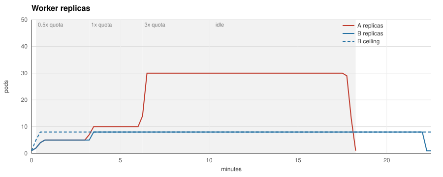
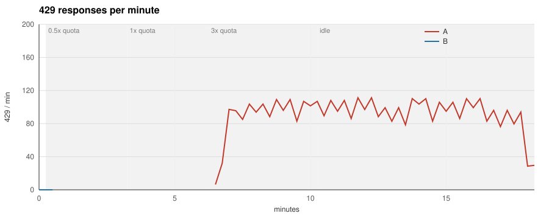
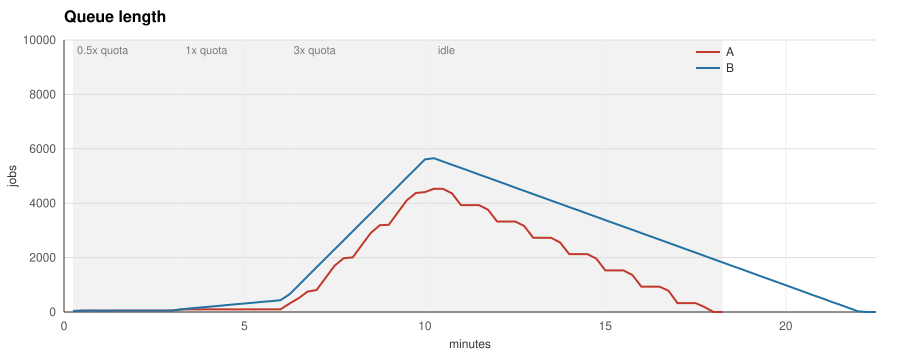

# quotaware benchmark 2026-11-01

Schedule `half:3m:0.5,full:3m:1,burst:4m:3,idle:4m:0` against a fake provider limited to 600 requests per minute, two calls in flight per worker pod, the same seed for both runs.

| Metric | A (queue trigger) | B (queue trigger + quotaware) |
|---|---|---|
| Jobs produced | 9900 | 9900 |
| Jobs completed | 9848 | 9875 |
| Jobs failed | 0 | 0 |
| 429 responses | 1140 | 0 |
| Retries | 1140 | 0 |
| Peak 429 per minute | 111 | 0 |
| Job latency p50 | 157.9 s | 263.4 s |
| Job latency p95 | 454.8 s | 689.3 s |
| Peak replicas | 30 | 8 |
| Pod-seconds | 23700 | 9945 |
| Idle pod-seconds (in backoff) | 13681 | 0 |
| Time to drain the burst | 465 s | 720 s |
| Time to react after the first 429 | n/a (no ceiling) | no 429 observed |
