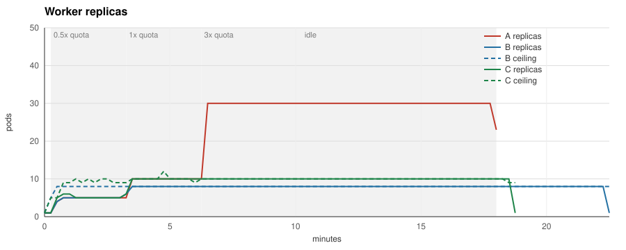
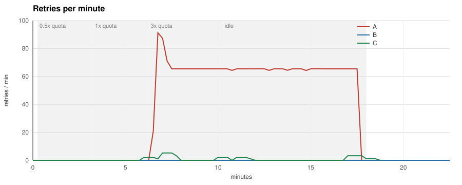
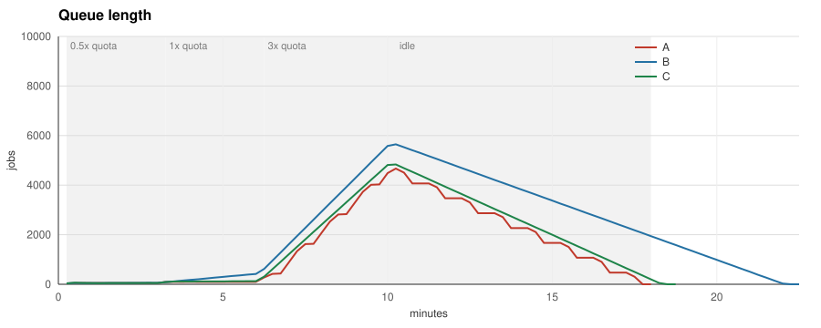

# quotaware benchmark 2026-11-02

Schedule `half:3m:0.5,full:3m:1,burst:4m:3,idle:4m:0` against a fake provider limited to 600 requests per minute, two calls in flight per worker pod, the same job schedule and prompt sizes for every run (producer seed 1). Built from commit `bfffc1c0f0f3d356f1e82f7b4220038c62a6cefc`.

- A: the KEDA Redis list trigger alone, ten jobs per replica, 1 to 30 pods.
- B: the same trigger capped by the quotaware ceiling at the default safety factor 0.85.
- C: the same cap with `safety: "1"`, so the ceiling is the full quota.

| Metric | A (queue trigger) | B (queue trigger + quotaware, safety 0.85) | C (queue trigger + quotaware, safety 1) |
|---|---|---|---|
| Jobs produced | 9900 | 9900 | 9900 |
| Jobs completed | 9900 | 9900 | 9900 |
| Jobs failed | 0 | 0 | 0 |
| Jobs abandoned on shutdown | 0 | 0 | 0 |
| Jobs unaccounted for | 0 | 0 | 0 |
| 429 responses | 720 | 0 | 15 |
| Retries | 720 | 0 | 15 |
| Peak retries per minute | 91 | 0 | 5 |
| Job latency p50 | 128.1 s | 263.6 s | 164.8 s |
| Job latency p95 | 457.7 s | 689.5 s | 463.1 s |
| Peak replicas | 30 | 8 | 10 |
| Pod-seconds | 23580 | 10050 | 10125 |
| Idle pod-seconds (in backoff) | 13300 | 0 | 8 |
| Time to drain the burst | 450 s | 720 s | 495 s |
