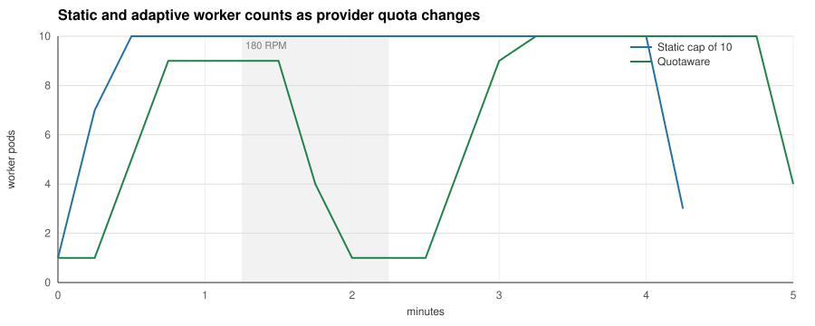
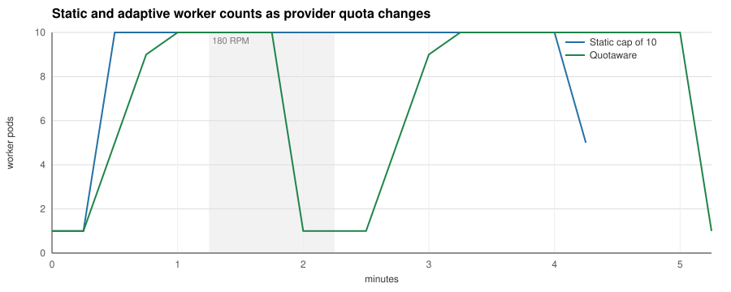

# Changing-quota benchmark, 2026-11-05

Six trials ran on one GitHub-hosted Ubuntu 24.04 amd64 runner between
2026-11-04 22:51 and 23:20 UTC, which is November 5 in Europe/Bucharest.
[Successful CI execution](https://github.com/dimonchik03/quotaware/actions/runs/41928303907).

The images were built from clean commit
[4b602e16c46a0eefed44002e16dbc223820ca2a1](https://github.com/dimonchik03/quotaware/commit/4b602e16c46a0eefed44002e16dbc223820ca2a1).
Go 1.26.10, kind 0.33.0, Kubernetes 1.37.0 and KEDA 2.21.0.
Each `run.json` records the source revision, schedule, arm and measurement bounds.
The raw JSON, generated charts and per-pass tables are the CI artifact contents.

- A scales on Redis queue depth, up to 30 workers.
- B uses the same queue trigger with a static maximum of 10.
- C caps the queue trigger with Quotaware, safety 1 and a maximum raise of four workers per 15-second interval.

Each trial enqueues 15 jobs per second for two minutes, then stops producing.
The fake provider permits 600 requests in minute one, 180 in minute two and
600 in subsequent minutes. The first request for the model anchors its minute
windows. The token limit stays at two million per minute. All trials use the
same seeded jobs, two concurrent calls per worker, two-second provider latency
with 200 ms jitter, and matching HPA behaviour.

Pass 1 runs A/B/C. Pass 2 runs C/B/A. The provider and scaler restart and the
workers are recreated between trials. All six observed the full 600/180/600
sequence. All replica exports have uninterrupted 15-second sampling.

Each cell shows pass 1 / pass 2. The second pass reverses A/B/C to C/B/A.
Quotaware uses `safety: "1"` and `maxStepUp: "4"`. The default safety setting is
0.85. All arms use two concurrent provider calls per worker.

| Metric | Queue only | Static cap of 10 | Quotaware |
|---|---|---|---|
| Jobs completed, out of 1,800 | 1,800 / 1,800 | 1,800 / 1,800 | 1,784 / 1,782 |
| Jobs abandoned on shutdown | 0 / 0 | 0 / 0 | 16 / 18 |
| HTTP 429 responses | 158 / 150 | 24 / 24 | 18 / 20 |
| Worker pod-seconds | 4,875 / 5,280 | 2,385 / 2,310 | 2,032.5 / 2,295 |
| Job latency p95 | 92.1 s / 92.1 s | 136.5 s / 136.5 s | 197.9 s / 206.9 s |
| Time from end of load phase to empty queue | 75 s / 75 s | 105 s / 105 s | 150 s / 165 s |

The adaptive ceiling follows the reduction in available quota and keeps fewer
workers alive through it. Across these two trials it uses about 8% fewer worker
pod-seconds than the static cap, while p95 rises into the next histogram bucket.
Its worker also abandons jobs when a scale-down interrupts retry backoff. Completed
jobs alone enter the latency histogram, so the resource totals must be read with
the completion counts. The static ten-worker cap completes this workload sooner
and preserves every job.

The worker uses a destructive Redis pop. A production worker needs queue leases
or requeue-on-shutdown behaviour for work between provider calls. Quotaware's drain
floor sees open HTTP calls. It cannot preserve a job sleeping between retries,
and KEDA can choose any worker to terminate.

The experiment demonstrates adaptation and its cost under a brief quota reduction.
The static cap performs well for this schedule. Performance for other quota schedules and real providers remains unmeasured.

## Reading the measurements

Worker pod-seconds integrate endpoints that Prometheus can scrape, including
the 15-second shutdown linger. End-of-load drain times have 15-second resolution
and measure when the Redis list becomes empty. Calls can still be finishing then.
Latency quantiles are interpolated from buckets spaced by a factor of 1.5.
Retry and backoff counters record waits when scheduled, including waits
interrupted by termination.

Every produced job is accounted for as completed or abandoned. All six trials have
zero failed and zero unaccounted jobs. The discarded laptop trials are excluded
from this dataset. Host suspension interrupted two attempts at the second static
trial, so the entire balanced experiment was rerun on this CI runner.

[Full table, pass 1](pass-1/summary.md) · [Full table, pass 2](pass-2/summary.md)

## Reproducing it

    git checkout 4b602e16c46a0eefed44002e16dbc223820ca2a1
    BENCH_RESULTS=/tmp/quotaware-new-results make bench-changing

Choose a new output directory. On macOS, prefix the command with `caffeinate -i`
and keep the laptop open. The GitHub benchmark workflow runs on relevant pushes to
main and can be dispatched manually on any branch.
