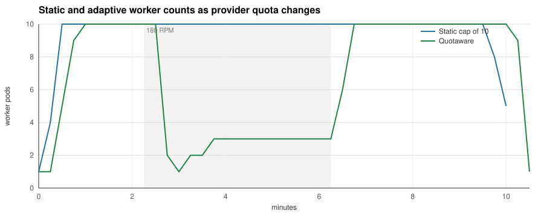
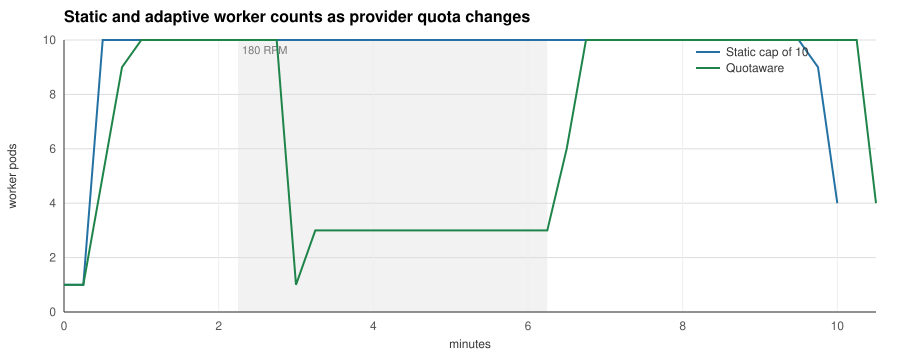
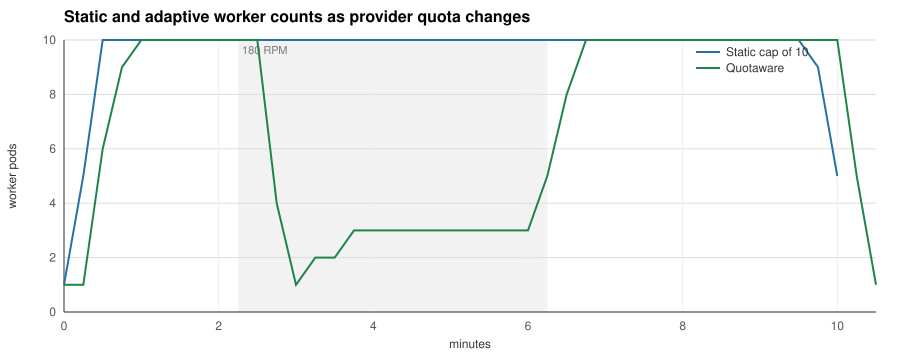

# Changing-quota benchmark, 2026-11-06

Nine trials ran on one GitHub-hosted Ubuntu 24.04 amd64 runner between
14:19 and 15:55 UTC on 2026-11-06.
[Successful CI execution](https://github.com/dimonchik03/quotaware/actions/runs/42232333742).

The images were built from clean commit
[6e3723bf8bfbcf9d10568354d85e1e3e04aeb8b4](https://github.com/dimonchik03/quotaware/commit/6e3723bf8bfbcf9d10568354d85e1e3e04aeb8b4).
Go 1.26.10, kind 0.33.0, Kubernetes 1.37.0 and KEDA 2.21.0.
Each `run.json` records the source revision, schedule, arm and measurement bounds.
The raw JSON, generated charts and per-pass tables are the CI artifact contents.

- A scales on Redis queue depth, up to 30 workers.
- B uses the same queue trigger with a static maximum of 10.
- C caps the queue trigger with Quotaware, safety 1, a look-ahead of 30 seconds and
  a maximum raise of four workers per 15-second interval.

Each trial enqueues 11 jobs per second for six minutes, then produces nothing for
one minute. The fake provider permits 600 requests in each of the first two
minutes, 180 in each of the next four and 600 in every minute after that. The
first request for the model anchors its minute windows. The token limit stays at
two million per minute. All trials use the same seeded jobs, two concurrent calls
per worker, two-second provider latency with 200 ms jitter, and matching HPA
behavior.

Pass 1 runs A/B/C, pass 2 C/B/A and pass 3 B/C/A. The provider and scaler restart
and the workers are recreated between trials. All nine observed the full
600/180/600 sequence, and every replica export has uninterrupted 15-second
sampling.

Each cell shows the lowest and the highest value over the three passes.

| Metric | Queue only | Static cap of 10 | Quotaware |
|---|---|---|---|
| Jobs completed, out of 3,960 | 3,960 | 3,960 | 3,960 |
| Jobs handed back on shutdown | 12–14 | 0 | 18 |
| HTTP 429 responses | 442 | 88–92 | 24–26 |
| Worker pod-seconds | 13,598–13,680 | 5,738–5,805 | 4,215–4,402 |
| Pod-seconds of scheduled retry backoff | 9,602–9,641 | 1,676–1,678 | 416–424 |
| Mean job latency | 113.2–114.5 s | 130.3–130.7 s | 156.0–161.6 s |
| Job latency p50 | 161.2–162.8 s | 196.2–196.4 s | 221.5–226.6 s |
| Job latency p95 | 199.8–200.7 s | 213.2–213.4 s | 238.2–243.4 s |
| Time from end of load phase to empty queue | 195 s | 210 s | 240 s |

In every pass Quotaware completes every job with 23–27% fewer worker pod-seconds
and about 72% fewer 429s than the static cap. Its mean job latency is 19–24% higher,
its p95 12–14% higher, and its queue empties 30 seconds later. Against the queue
trigger alone it uses 68–69% fewer pod-seconds and receives about 94% fewer 429s,
with a p95 19–21% higher.

## Reading the measurements

Worker pod-seconds integrate endpoints that Prometheus can scrape, including the
15-second shutdown linger. End-of-load drain times have 15-second resolution and
measure when the Redis list becomes empty. Calls can still be finishing then. Job
latency runs from enqueue to completion. The mean comes from the histogram's sum
and count; p50 and p95 are interpolated in five-second buckets. A job handed back
on shutdown keeps its enqueue time. Retry and backoff counters record waits when
they are scheduled, including waits interrupted by termination.

Every produced job is completed. All nine trials have zero failed, abandoned and
unaccounted jobs.

[Pass 1](pass-1/summary.md) · [Pass 2](pass-2/summary.md) · [Pass 3](pass-3/summary.md)

## Reproducing it

    git checkout 6e3723bf8bfbcf9d10568354d85e1e3e04aeb8b4
    BENCH_RESULTS=/tmp/quotaware-new-results make bench-changing

Choose a new output directory. On macOS, prefix the command with `caffeinate -i`
and keep the laptop open. The GitHub benchmark workflow runs on relevant pushes to
main and can be dispatched manually on any branch.
