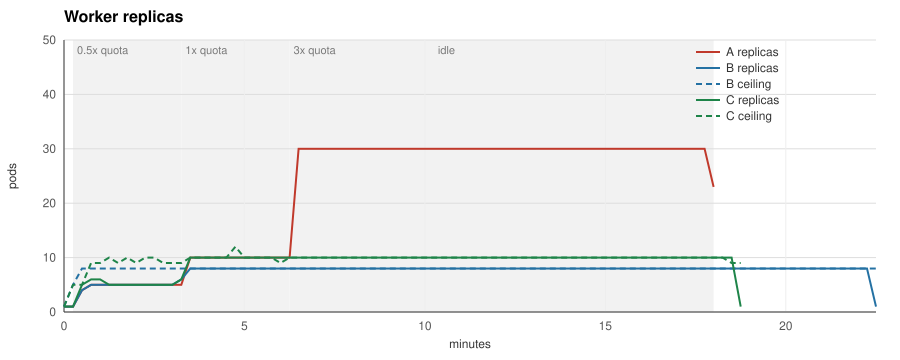
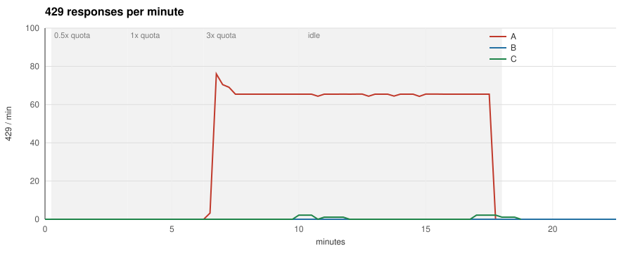

# Benchmark

Three runs on a laptop `kind` cluster, identical except for the ScaledObject, zero
provider tokens spent. All scale the same worker deployment against the same fake
provider with the same job schedule.

## Setup

- Provider: `bench/fakeprovider`, 600 requests and 2,000,000 tokens per minute for
  the model, fixed window, 2 s latency with 200 ms jitter, OpenAI-style headers,
  429 with `retry-after` when the window is spent.
- Workers: `bench/worker`, two calls in flight per pod, SDK-style retry (exponential
  backoff from one second, capped at a minute, 25 % jitter, never before
  `retry-after`), six attempts per job, graceful shutdown on SIGTERM that counts the
  jobs it had to abandon and lingers 15 s so the last counters are scraped.
- Producer: `bench/producer`, one process pushing jobs into a Redis list at a
  multiple of the provider quota (10 jobs per second): `half:3m:0.5`, `full:3m:1`,
  `burst:4m:3`, `idle:4m:0`. Prompt sizes vary within 200 ± 50 tokens from a fixed
  seed, so every run sees the same jobs.
- Run A, the baseline: KEDA Redis list trigger, ten jobs per replica, 1 to 30 pods.
- Run B: the same trigger capped by the quotaware ceiling through `scalingModifiers`
  at the default `safety` of 0.85, with `concurrency: "2"` to match the worker and
  `maxStepUp: "4"`, twice the default, so the ceiling may rise by four pods per
  15 s step (`bench/manifests/scaledobject-b.yaml`).
- Run C: the same cap with `safety: "1"` (`bench/manifests/scaledobject-c.yaml`).
- Prometheus scrapes the workers, the producer and quotaware every five seconds;
  `bench/bench.sh` exports the series and `bench/cmd/plot` draws the charts and the
  table. Everything, including the commit the images were built from, is committed
  under `bench/results/<date>/`.

## Hypothesis, written before the first run

Under quota both runs look the same, and quotaware must not hurt there. At and above
quota, run B shows fewer 429s, fewer pod-seconds and a lower p95 at the same
throughput, because throughput is capped by the quota either way. If B does not win,
that is still the write-up, and a bug hunt.

## What is measured per run

Replicas over time, 429 per minute, retries, jobs completed per minute, job latency
p50 and p95 from enqueue to completion, time to drain the burst (from the end of the
burst phase until the queue is empty), total pod-seconds (the area under the replica
curve), idle pod-seconds (seconds spent in backoff divided by the calls per pod),
jobs abandoned on shutdown and jobs unaccounted for (produced minus completed,
failed and abandoned).

## Running it

    make bench          # full schedule, about an hour for the three runs
    make bench-smoke    # two-minute schedule to check the pipeline

The cluster is the one `make demo` uses, with its own kubeconfig under `bench/kind/`;
`make demo-down` deletes it.

## Results, 2026-11-02

`bench/results/2026-11-02/`, built from commit `bfffc1c` with a clean tree, produced
by `make bench` on a MacBook with 16 GB of memory, kind v0.33, KEDA 2.21.0, Go 1.26.5.
Run A took 1091 s, run B 1352 s, run C 1128 s, including the drain after the schedule.

| Metric | A (queue trigger) | B (queue trigger + quotaware, safety 0.85) | C (queue trigger + quotaware, safety 1) |
|---|---|---|---|
| Jobs produced | 9900 | 9900 | 9900 |
| Jobs completed | 9900 | 9900 | 9900 |
| Jobs failed | 0 | 0 | 0 |
| Jobs abandoned on shutdown | 0 | 0 | 0 |
| Jobs unaccounted for | 0 | 0 | 0 |
| 429 responses | 720 | 0 | 15 |
| Retries | 720 | 0 | 15 |
| Peak 429 per minute | 76 | 0 | 2 |
| Job latency p50 | 128.1 s | 263.6 s | 164.8 s |
| Job latency p95 | 457.7 s | 689.5 s | 463.1 s |
| Peak replicas | 30 | 8 | 10 |
| Pod-seconds | 23580 | 10050 | 10125 |
| Idle pod-seconds (in backoff) | 13300 | 0 | 8 |
| Time to drain the burst | 450 s | 720 s | 495 s |

## Result against the hypothesis

- *Under quota both runs look the same.* Holds in the 0.5x phase. In the 1.0x phase B
  already falls behind: its ceiling of 8 pods completes about 460 jobs per minute
  against 600 produced, so its queue grows from 55 to 417 while A's stays near 100.
  C keeps up with A.
- *Fewer 429s.* Holds. A 720, B 0, C 15.
- *Fewer pod-seconds.* Holds. A 23580, B 10050, C 10125. A spent 13300 pod-seconds,
  more than half of its total, in backoff.
- *Lower p95 at the same throughput.* Does not hold for B and holds within 2 % for C.
  B's p95 is 689.5 s against A's 457.7 s and the burst drains in 720 s instead of
  450 s, because the default safety factor leaves 20 % of the quota unused:
  floor(600 / 60 × 0.85) is 8 pods, which sustain 480 calls per minute. C reaches the
  full quota with 10 pods: p95 463.1 s, drain 495 s, 15 429s against 720. The median
  moves more than the tail: p50 is 128.1 s for A, 263.6 s for B and 164.8 s for C.

The trade-off is the safety factor. At 0.85 quotaware buys zero 429s with 50 % more
p95 latency and twice the p50 under sustained overload; at 1 it matches the
baseline's p95 within 2 % and its p50 within 30 % at 43 % of the pod-seconds and
2 % of the 429s. C's 15 429s are the fixed window's
edge: ten pods at about one call per second each sit exactly on 600 per minute, and
latency jitter occasionally pushes a window over.

Reading the table: totals are the per-pod maxima of each counter over the run, and
the worker lingers 15 s after its last job so the final values are scraped, which is
why every produced job is accounted for. Latencies are from enqueue to completion
across the whole run. Pod-seconds integrate the replica series; idle pod-seconds are
the seconds workers spent sleeping on a 429 divided by the two calls per pod. The
drain time runs from the end of the 3x phase to the first empty queue.

## Superseded results, 2026-11-01

`bench/results/2026-11-01/` is kept for the record and should not be quoted. The
worker applied its jitter after `retry-after` and so retried up to 25 % early, which
inflated run A's 429s to 1140 against the 720 measured here; the export missed run
B's 429 series; the images came from an uncommitted tree; and 77 jobs were lost to
the last unscraped seconds of terminated pods. The direction of every row was the
same as above.
