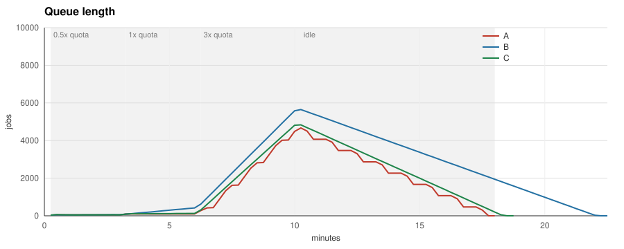

# Benchmark

Three runs on a laptop `kind` cluster, zero provider tokens spent. They share the
workers, the producer schedule and seed and the HPA behaviour; only the ScaledObject
differs by design. The fake provider and Prometheus ran on across the runs, so each run
met the minute window at a different phase, and each variant ran once, in the order
A, B, C.

## Setup

- Provider: `bench/fakeprovider`, 600 requests and 2,000,000 tokens per minute for
  the model in one fixed minute window that every key shares, 2 s latency with 200 ms
  jitter, OpenAI-style headers, 429 with `retry-after` up to the reset when the window
  is spent; a rejected call does not count against the window and acceleration
  limits are off. Only the request limit binds: about 365 tokens per call.
- Workers: `bench/worker`, two calls in flight per pod, SDK-style retry (exponential
  backoff from one second, capped at a minute, then ±25 % jitter, never before
  `retry-after`), six attempts per job, graceful shutdown on SIGTERM that counts the
  jobs it had to abandon and lingers 15 s after SIGTERM so the last counters are scraped.
- Producer: `bench/producer`, one process pushing jobs into a Redis list at a
  multiple of the provider quota (10 jobs per second): `half:3m:0.5`, `full:3m:1`,
  `burst:4m:3`, `idle:4m:0`. Prompt sizes vary within 200 ± 50 tokens from a fixed
  seed, so every run sees the same jobs.
- Run A, the baseline: KEDA Redis list trigger, ten jobs per replica, 1 to 30 pods.
- Run B: the same trigger capped by the quotaware ceiling through `scalingModifiers`
  at the default `safety` of 0.85, with `concurrency: "2"` to match the worker and
  `maxStepUp: "4"`, twice the default, so the ceiling may rise by four pods per
  15 s step (`bench/manifests/scaledobject-b.yaml`).
- Run C: the same cap with `safety: "1"` (`bench/manifests/scaledobject-c.yaml`).
  C is exploratory: it was added after the first results showed B losing on latency,
  to measure what the default safety factor costs, and the hypothesis below predates
  it.
- Prometheus scrapes the workers, the producer and quotaware every five seconds;
  `bench/bench.sh` exports the series and `bench/cmd/plot` draws the charts and the
  table. Everything, including the commit the images were built from, is committed
  under `bench/results/<date>/`.

## Hypothesis, written before the first run

Under quota both runs look the same, and quotaware must not hurt there. At and above
quota, run B shows fewer 429s, fewer pod-seconds and a lower p95 at the same
throughput, because throughput is capped by the quota either way. If B does not win,
that is still the write-up, and a bug hunt.

## What is measured per run

Replicas over time, 429 per minute, retries, jobs completed per minute, job latency
p50 and p95 from enqueue to completion, time to drain the burst (from the end of the
burst phase until the queue is empty), total pod-seconds (the area under the replica
curve), idle pod-seconds (seconds spent in backoff divided by the calls per pod),
jobs abandoned on shutdown and jobs unaccounted for (produced minus completed,
failed and abandoned).

## Running it

    make bench          # full schedule, about an hour for the three runs
    make bench-smoke    # short schedule, about three minutes per run, to check the pipeline

The cluster is the one `make demo` uses, with its own kubeconfig under `bench/kind/`;
`make demo-down` deletes it.

## Results, 2026-11-02

`bench/results/2026-11-02/`, built from commit `bfffc1c` with no changes to tracked files, produced
by `make bench` on a MacBook with 16 GB of memory, kind v0.33, KEDA 2.21.0, Go 1.26.5.
Run A took 1091 s, run B 1352 s, run C 1128 s, including the drain after the schedule.
Each variant ran once. The commits after `bfffc1c` changed the scaler only for
credentials the provider has not answered yet, responses other than 2xx and 429, and
gRPC callers other than KEDA's trigger (ADR 0009); of these only the first occurs,
for the second or two before each run's first response. Later commits also count the
step interval from the last change of the bound and add a NetworkPolicy and a gRPC
probe peer to the kind setup, so a run on the current commit may step up differently.

| Metric | A (queue trigger) | B (queue trigger + quotaware, safety 0.85) | C (queue trigger + quotaware, safety 1) |
|---|---|---|---|
| Jobs produced | 9900 | 9900 | 9900 |
| Jobs completed | 9900 | 9900 | 9900 |
| Jobs failed | 0 | 0 | 0 |
| Jobs abandoned on shutdown | 0 | 0 | 0 |
| Jobs unaccounted for | 0 | 0 | 0 |
| 429 responses | 720 | 0 | 15 |
| Retries | 720 | 0 | 15 |
| Peak retries per minute | 91 | 0 | 5 |
| Job latency p50 | 128.1 s | 263.6 s | 164.8 s |
| Job latency p95 | 457.7 s | 689.5 s | 463.1 s |
| Peak replicas | 30 | 8 | 10 |
| Pod-seconds | 23580 | 10050 | 10125 |
| Idle pod-seconds (in backoff) | 13300 | 0 | 8 |
| Time to drain the burst | 450 s | 720 s | 495 s |

## Result against the hypothesis

- *Under quota both runs look the same.* Holds in the 0.5x phase. In the 1.0x phase B
  already falls behind: its ceiling of 8 pods completes about 480 jobs per minute
  against 600 produced, so its queue grows from 55 to 417 while A's stays near 100.
  C nearly keeps up: its queue grows from 87 to 124 while A's stays near 100.
- *Fewer 429s.* Holds. A 720, B 0, C 15.
- *Fewer pod-seconds.* Holds. A 23580, B 10050, C 10125. A spent 13300 pod-seconds,
  more than half of its total, in backoff.
- *Lower p95 at the same throughput.* Does not hold. B's p95 is 689.5 s against A's
  457.7 s and the burst drains in 720 s instead of 450 s, because the default safety
  factor leaves 20 % of the quota unused: floor(600 / 60 × 0.85) is 8 pods, which
  sustain 480 calls per minute. C reaches the full quota with 10 pods and ties A on
  p95 (463.1 s against 457.7 s, inside the same histogram bucket, see below), but
  its p50 sits one bucket higher (164.8 s against 128.1 s, about 29 % by
  interpolation) and it takes 10 % longer to drain the burst (495 s against 450 s).

The trade-off is the safety factor. At 0.85 quotaware buys zero 429s and less than
half the pod-seconds with a p95 one bucket and a p50 two buckets higher (about 50 %
and twice by interpolation) under sustained overload. At 1 it ties the baseline's
p95, its p50 is one bucket higher and the drain 10 % longer, at 43 % of the
pod-seconds and 2 % of the 429s. Throughput is capped by the quota either way, so
the queue trigger alone does not lengthen the queue here; what it wastes is pods
sleeping in backoff and the retries they send. C's 15
429s are the fixed window's edge: ten pods at about one call per second each sit
exactly on 600 per minute, and latency jitter occasionally pushes a window over.

What this benchmark does not show: the quota, the latency and the set of consumers
are constant, so a static `maxReplicaCount` of 10 on the queue trigger would likely
match run C. The ceiling is meant for headroom that moves, for instance when another
credential spends the shared quota; the kind demo in the README shows that case and
a later benchmark run should measure it. B's ceiling sat at 8 from its first 30
seconds to the end, so B behaved as a static cap of 8.

The fixed window also flatters the baseline. When A jumps to 30 pods it spends the
rest of one window and all of the next back to back, up to 1026 completions in one
minute against a quota of 600, and then front-loads every later window, because each
429 carries a `retry-after` up to the reset and all of A's call slots wake together.
That keeps A 140 to 500 jobs ahead of C through the burst, about the size of C's p50
and drain gaps. The fake provider does not charge a rejected call against its window,
while OpenAI counts unsuccessful requests against the per-minute limit. A provider
that refills continuously, or one with acceleration limits on, would remove A's head
start and raise its 429 count; neither was run.

Reading the table: totals are the per-pod maxima of each counter over the run, and
the worker lingers 15 s after SIGTERM so the final values are scraped, which is
why every produced job is accounted for. Latencies are from enqueue to completion
across the whole run, interpolated from a histogram whose buckets grow by a factor
of 1.5: p95 values between 328 s and 493 s share one bucket, so differences of a few
percent inside it are not measured, while the three p50 values fall in three
different buckets. Between buckets only the order is measured; the percentages above
come from the interpolation. Pod-seconds integrate the replica series, which counts
worker pods whose metrics endpoint is up, including the 15 s linger; idle pod-seconds are
the seconds workers spent sleeping on a 429 divided by the two calls per pod. The
drain time runs from the end of the 3x phase to the first empty queue, at the 15 s
resolution of the export, so 450 s and 495 s are three samples apart. The 429 row
counts each pod's 429 total; the per-minute row and chart use retries, because the
429 series of a pod only appears at its first 429 and a rate misses that step. In
these runs every retry followed a 429.

## Superseded results, 2026-11-01

`bench/results/2026-11-01/` is kept for the record and should not be quoted. The
worker applied its jitter after `retry-after` and so retried up to 25 % early, which
inflated run A's 429s to 1140 against the 720 measured here; the export missed run
B's 429 series; the images came from an uncommitted tree; and 77 jobs were lost to
the last unscraped seconds of terminated pods. The direction of every row was the
same as above.
